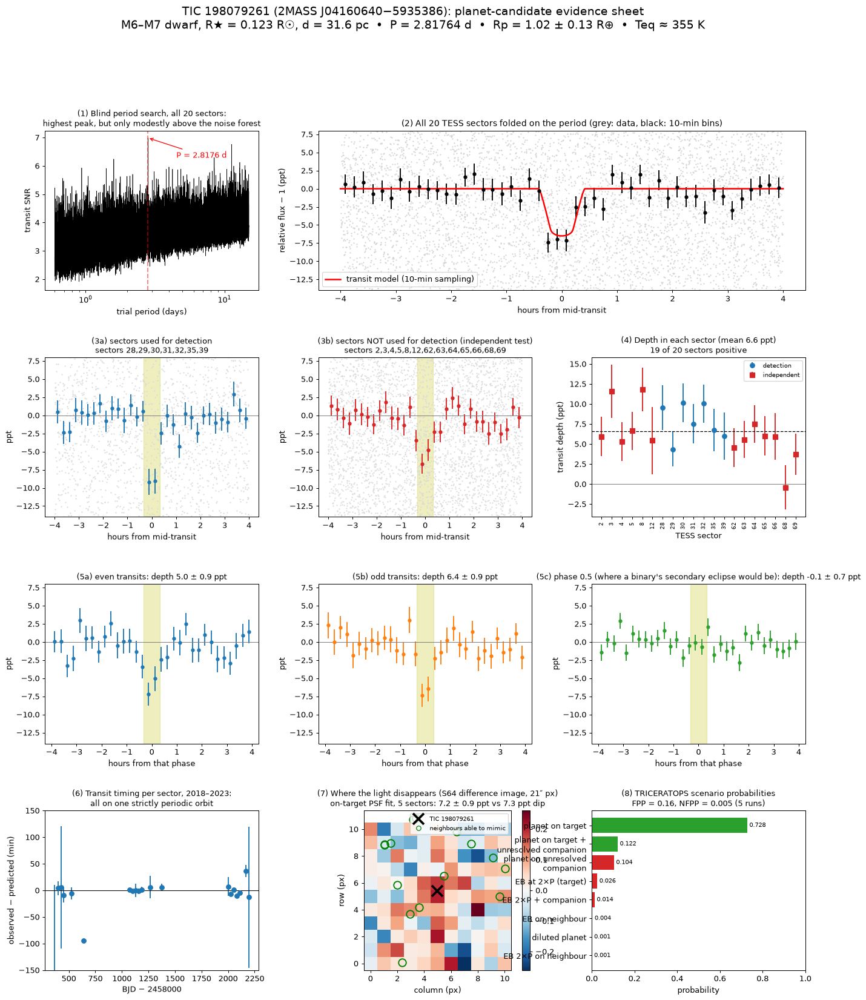

# Two transiting planet candidates around nearby M dwarfs from an independent TESS search

**Author:** Sarang Park (박사랑), Korea Science Academy of KAIST. This work was a term project for General Astronomy.
**First public posting:** 23 October 2026 (see the commit history of this repository).

> **Status: planet *candidates*, not confirmed planets.** Confirming them needs ground-based transit photometry, high-resolution imaging and spectroscopy. Follow-up observations and comments are very welcome; please open an issue.

As of 23 October 2026, neither signal appears in any of these:
- the TESS TOI or CTOI lists, or the NASA Exoplanet Archive;
- the SPOC 2-min TCE catalogs (132 runs through sector 96);
- the TESS-SPOC FFI data-validation releases (51 releases, 114,293 TCE host stars);
- the public candidate lists of other community searches ([ahrazzle/exoplanets](https://github.com/ahrazzle/exoplanets), [tess-transit-hunter](https://github.com/Comdex4/tess-transit-hunter));
- web search results for the stars' TIC, 2MASS and Gaia identifiers.

## Candidates

| | **TIC 198079261** | **TIC 366760231** |
|---|---|---|
| Other IDs | 2MASS J04160640−5935386, Gaia DR3 4678628654309752576 | 2MASS J22202826+7427466, Gaia DR3 2279461636455560576 |
| RA, Dec (J2000) | 04h 16m 06.4s, −59° 35′ 39″ | 22h 20m 28.3s, +74° 27′ 47″ |
| Host star (TIC v8.2) | ultracool M6–M7 dwarf; Teff 2825 K; 0.123 R☉; 0.099 M☉; 31.6 pc; T = 15.03 | M dwarf; Teff 3456 K; 0.389 R☉; 0.379 M☉; 55.3 pc; T = 12.39 |
| **Period** | **2.817636 ± 0.000018 d** | **3.137321 ± 0.000003 d** |
| **Mid-transit (BJD_TDB)** | **2460071.6821 ± 0.0024** | **2458962.04155 ± 0.00061** |
| Depth | 6520 ± 1440 ppm (fit); ~7300 ppm (box) | ~1640–1915 ppm |
| Duration T14 | 0.66 ± 0.08 h | ~0.54–0.60 h |
| Planet radius | **1.02 ± 0.13 R⊕** | ~1.9–2.5 R⊕ |
| Equilibrium temperature (A = 0) | ~355 K | ~600 K |
| TESS data | 20 sectors of TESS-SPOC FFI light curves (2018–2023) | 6 SPOC 2-min + 3 TESS-SPOC FFI sectors (2019–2025) |
| Independent recovery | 13 sectors not used for detection: ~4.9σ against random-phase scans | 3 FFI sectors not used for detection: ~6σ |
| TRICERATOPS FPP / NFPP | 0.16 ± 0.01 / 0.005 | 0.26 ± 0.02 / < 0.001 |
| Details | [candidates/TIC198079261](candidates/TIC198079261/README.md) | [candidates/TIC366760231](candidates/TIC366760231/README.md) |

Machine-readable ephemerides and fits are in `candidates/*/ephemeris.json` and `candidates/*/fit_results.json`. Predicted transit times are in `candidates/*/upcoming_transits.md`. A 9-page summary is in [`report/TESS_planet_candidates_report.pdf`](report/TESS_planet_candidates_report.pdf).

## Evidence summary

**TIC 198079261**
- **Detection and independent recovery:** detected in TESS-SPOC FFI sectors 28–39. The transit is recovered at the predicted ephemeris in the 13 sectors not used for detection, and 19 of 20 sectors give a positive depth.
- **Binary tests:** odd and even transits are consistent (6.4 ± 0.9 vs 5.0 ± 0.9 ppt). No secondary eclipse is seen (−0.1 ± 0.7 ppt).
- **Source location:** a target-PSF fit to stacked difference images (5 sectors) recovers 7.2 ± 0.9 ppt, matching the light-curve depth. The nearest Gaia source able to mimic the signal is 26″ away. Gaia RUWE is 1.02.
- **Host density:** the stellar density from the transit shape alone (90 +64/−66 g cm⁻³) agrees with the TIC value (75 ± 17).
- **Caveats:** the star is faint (T = 15.0) and the per-sector SNR is only ~3–4. A blind all-sector periodogram shows the period as the highest peak, but only modestly above the noise. An unresolved companion within ~1″ is not excluded.

**TIC 366760231**
- **Detection and independent recovery:** detected in 2-min sectors 17–25 and recovered in independent FFI sectors 58, 59 and 85. Nine per-sector mid-times (2019–2025) fit a linear ephemeris. No secondary eclipse is seen.
- **Caveats:** the short duration needs a high impact parameter (b ≈ 0.93–0.97 with the TIC density), so the radius is poorly constrained. Difference images are too shallow to localise the signal directly. The nearest capable Gaia neighbour is 11.9″ away; TRICERATOPS gives it negligible probability.

## Method (short)
1. **Light curves:** public SPOC 2-min and TESS-SPOC FFI PDCSAP light curves from MAST.
2. **Pre-processing:**
   - flare masking;
   - a 0.75-d detrend;
   - a common-mode bad-time mask built from ~90,000 stars;
   - removal of isolated outliers;
   - per-segment prewhitening of stellar rotation.
3. **Search:** a GPU box-least-squares search over 0.5–40 d, three signals per star, across more than 80,000 M dwarfs.
4. **Automatic vetting:**
   - odd/even and secondary-eclipse tests;
   - per-transit consistency, few-epoch dominance and duration-plausibility tests;
   - rotation-harmonic and shared-ephemeris systematics tests;
   - cross-matching against TOIs, CTOIs, the Exoplanet Archive, all SPOC and TESS-SPOC TCEs, the TESS EB catalog and public community lists;
   - a CNN-ensemble plus gradient-boosting vetter (ranking only), trained on injected transits, TOI dispositions, TESS EBs and labelled search signals.
5. **Deep vetting of top candidates:**
   - independent-sector recovery with a look-elsewhere-calibrated null;
   - alias scans and per-sector depths;
   - difference images and a target-PSF fit;
   - Gaia DR3 neighbour census;
   - MCMC transit fits (batman, emcee) with and without a stellar-density prior;
   - TRICERATOPS (Giacalone et al. 2021).

Code is in [`code/`](code/). See [`code/README.md`](code/README.md) for notes.

## Signals recovered by this search but reported earlier by others
These signals are **not** claimed here. They are listed to credit the earlier reports:
- **G 249-11 = TIC 417732194** (P = 5.307 d): posted first by [tess-transit-hunter](https://comdex4.github.io/tess-transit-hunter/findings.html) on 2026-10-05. Our independent analysis also finds a 3.1σ dip at the predicted times in archival MEarth-North photometry from 2011–12.
- **TIC 355815567** (P = 3.519 d): in the [ahrazzle/exoplanets](https://github.com/ahrazzle/exoplanets) candidate list.
- **TIC 286763141** (P = 7.349 d, second signal on TOI-6284): SPOC multi-sector TCE.
- **TIC 38699429** (P = 11.718 d): TESS-SPOC FFI TCE (sectors 56–69).

## AI assistance
This project was carried out with substantial help from an AI assistant, **Claude (Anthropic)**, working under the author's direction.
- **The assistant wrote most of the code and ran most of the analysis:** the data download and pre-processing pipeline, the GPU transit search, the machine-learning vetters, the deep-vetting and transit-fitting scripts, and the figures. It also drafted the candidate write-ups and this README.
- **The author** chose the project and its direction, made the decisions about scope, targets and follow-up, reviewed the results, and is responsible for the content of this repository.

All results can be reproduced from the public data with the code here.

## Data credits
This work uses data from the TESS mission, funded by NASA's Science Mission Directorate, obtained from the Mikulski Archive for Space Telescopes (MAST). That includes SPOC and TESS-SPOC (Caldwell et al. 2020) light curves and data-validation products. It also uses data from the ESA *Gaia* mission (Gaia DR3), the TESS Input Catalog v8.2 (Stassun et al. 2019), ExoFOP-TESS and the NASA Exoplanet Archive. Archival MEarth photometry (Berta et al. 2012) was used for G 249-11.

## How to cite
Park, S. (2026), *Two transiting planet candidates around nearby M dwarfs from an independent TESS search (TIC 198079261, TIC 366760231)*, Zenodo, [doi:10.5281/zenodo.23586756](https://doi.org/10.5281/zenodo.23586756) (all versions; v1.0.0 = [10.5281/zenodo.23586757](https://doi.org/10.5281/zenodo.23586757)). See also [`CITATION.cff`](CITATION.cff).

## License
Code: MIT (see `LICENSE`). Text, figures and tables: CC BY 4.0.
