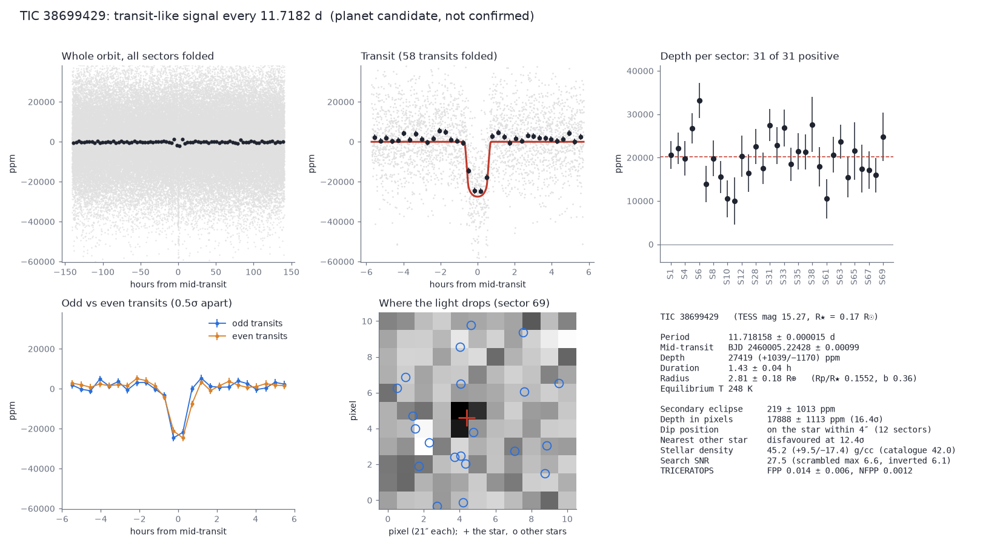
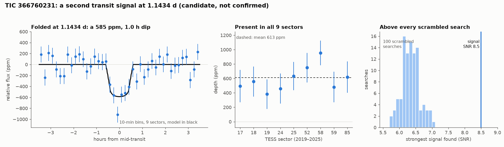
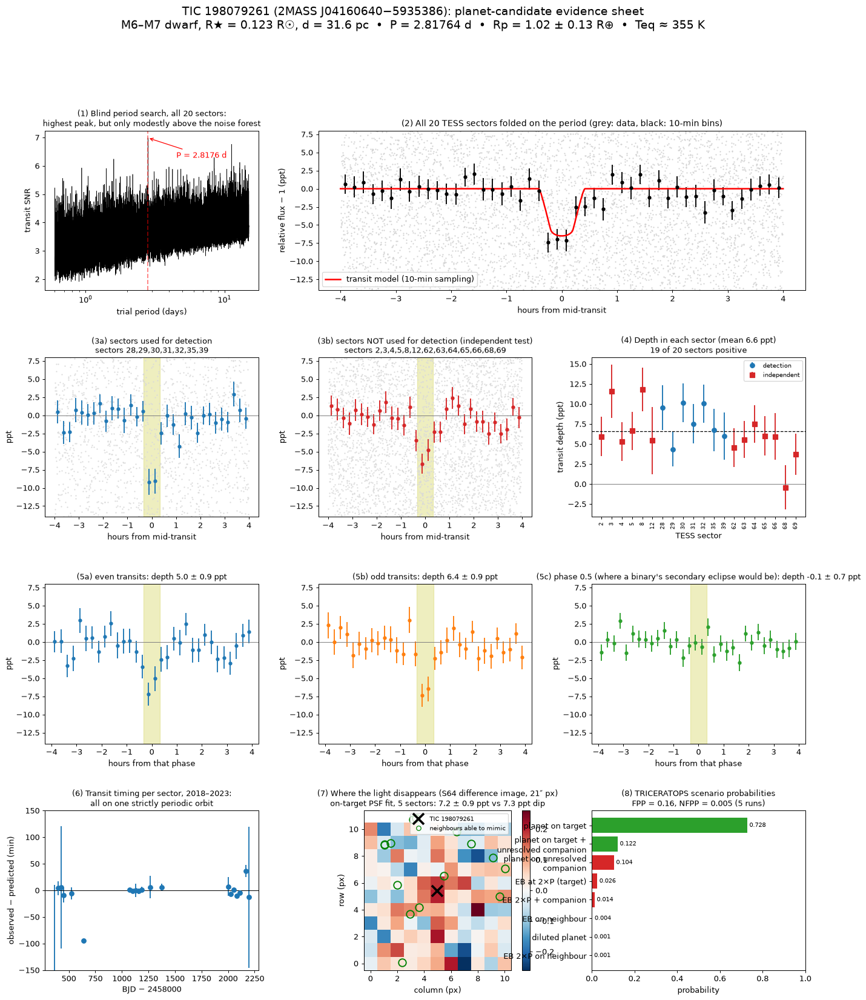

# Transiting planet candidates around nearby M dwarfs from an independent TESS search

**Author:** Sarang Park (박사랑), Korea Science Academy of KAIST. This work was a term project for General Astronomy.
**First public posting:** 23 October 2026. **Updated:** 16 November 2026 (v1.2.0). See the commit history of this repository.

## Update, 16 November 2026 (v1.2.0)

The all-sector re-search started in v1.1.0 (every available TESS sector for each star) has now covered about 6,300 of 27,500 stars. This version adds six signals that pass the checks listed below. All six are **planet candidates, not confirmed planets**, and the search is still running.

### Three signals with no earlier detection that I could find

No TOI, CTOI, SPOC or TESS-SPOC TCE, or entry in the lists named under the tables.

| | [**TIC 9066956.01**](candidates/TIC9066956/README.md) | [**TIC 166760940.01**](candidates/TIC166760940/README.md) | [**TIC 207503003.01**](candidates/TIC207503003/README.md) |
|---|---|---|---|
| Star | 2MASS J23462610−1147476 | LEHPM 2538 | LP 137-33 |
| TESS mag, distance | 13.86, 90 pc | 14.74, 88 pc | 14.46, 67 pc |
| Period (d) | 0.713448 ± 0.000001 | 3.102854 ± 0.000005 | 0.541886 ± 0.000001 |
| Mid-transit (BJD_TDB) | 2460198.51948 ± 0.00060 | 2460184.71033 ± 0.00181 | 2460368.69833 ± 0.00170 |
| Depth (ppm) | 5335 ± 307 | 17035 ± 1173 | 2620 (+391/−341) |
| Duration T14 (h) | 0.71 ± 0.03 | 1.09 ± 0.06 | 0.55 ± 0.06 |
| Radius (R⊕) | 2.81 ± 0.18 | 3.58 ± 0.25 | 1.29 ± 0.13 |
| Equilibrium temperature (A = 0) | 904 K | 486 K | 841 K |
| Search SNR (highest in scrambled copies) | 17.0 (7.4) | 13.4 (7.0) | 8.6 (6.7) |
| Sectors with positive depth | 5 of 5 | 4 of 4 | 16 of 16 |
| Pixel fit: nearest star able to mimic it | disfavoured at 3.5σ | disfavoured at 5.9σ | disfavoured at 6.0σ |
| TRICERATOPS FPP / NFPP | 0.035 ± 0.004 / < 0.001 | 0.30 ± 0.02 / 0.21 | 0.114 / 0.019 |
| Main weakness | a 2.8 R⊕ planet at 0.71 d would be rare | **low confidence:** FPP 0.30, Rp/R★ = 0.12 | **low SNR:** seen only when 16 sectors are added |

### Three pipeline detections (TCEs) that never became TOIs, vetted here

These are **not first detections**. The SPOC or TESS-SPOC pipeline lists an automatic threshold-crossing event (TCE) at the same period for each star, but none has a TOI or CTOI. What is new here is the independent detection with all sectors and the vetting.

| | [**TIC 38699429.01**](candidates/TIC38699429/README.md) | [**TIC 61710094.01**](candidates/TIC61710094/README.md) | [**TIC 149390648.01**](candidates/TIC149390648/README.md) |
|---|---|---|---|
| Star | 2MASS J04244516−6200307 | LP 931-48 | 2MASS J05361762−6212152 |
| TESS mag, distance | 15.27, 58 pc | 11.05, 24 pc | 13.36, 74 pc |
| Pipeline TCE | TESS-SPOC FFI, sectors 56–69, 11.7187 d | SPOC 2-min, three multi-sector runs, 1.8389 d | SPOC 2-min, sectors 1–96, 2.8369 d |
| Period (d) | 11.718158 ± 0.000015 | 1.838963 ± 0.000002 | 2.836870 ± 0.000009 |
| Mid-transit (BJD_TDB) | 2460005.22428 ± 0.00099 | 2460886.07295 ± 0.00119 | 2460201.90485 ± 0.00313 |
| Depth (ppm) | 27419 (+1039/−1170) | 810 (+63/−74) | 898 (+99/−104) |
| Duration T14 (h) | 1.43 ± 0.04 | 0.97 ± 0.05 | 1.12 ± 0.10 |
| Radius (R⊕) | 2.81 ± 0.18 | 1.02 ± 0.08 | 1.07 ± 0.09 |
| Equilibrium temperature (A = 0) | 248 K | 654 K | 575 K |
| Search SNR (highest in scrambled copies) | 27.5 (6.6) | 12.0 (6.2) | 10.3 (6.7) |
| Sectors with positive depth | all 31 | 4 of 4 | 39 of 42 |
| Pixel fit: nearest star able to mimic it | disfavoured at 12.4σ | not separable (a T = 18.6 star 5″ away) | disfavoured at 2.6σ |
| TRICERATOPS FPP / NFPP | 0.014 ± 0.006 / 0.0012 | 0.074 ± 0.007 / 0.005 | 0.056 ± 0.006 / < 0.001 |

TIC 38699429 was listed in earlier versions of this page under "reported earlier by others" because of its pipeline TCE. With all 31 sectors it is a 2.7 % deep, flat-bottomed transit every 11.7 d on a ~2900 K M dwarf, which corresponds to a 2.8 R⊕ object receiving about 0.6 times the Earth's insolation. I do not know whether the TESS team has reviewed this TCE and set it aside.

**Read these numbers with the following in mind.**
- The FPP values are optimistic: TRICERATOPS could not evaluate background-star scenarios here (no field-star population was available), and it does not use the pixel-fit result.
- Radii scale with the TIC stellar radii, which are uncertain by 10 % or more for the coolest stars.
- Each candidate page has its own list of caveats. Please read it before using a candidate.

**Lists checked for the six stars (16 November 2026):** the TOI and CTOI lists by TIC number and by position within 3′; ExoFOP-TESS; the NASA Exoplanet Archive; SPOC 2-min TCEs and the TESS-SPOC FFI TCE index; Lastovka et al. 2026; the T16 Planet Hunt candidates (Roth et al. 2026, [arXiv:2604.18579](https://arxiv.org/abs/2604.18579)); DIAmante (Montalto et al. 2020, 2023); NEMESIS (Feliz et al. 2021, [arXiv:2103.05647](https://arxiv.org/abs/2103.05647)); Gillis, Cloutier & Pass 2026 ([arXiv:2602.23364](https://arxiv.org/abs/2602.23364)); the two community lists named below; and the SIMBAD bibliography of each star.

**Checks added in this version.**
1. **Noise floor with the signal removed.** The same search is run on 20–30 copies of each light curve in which every sector is shifted by a random offset, after masking the candidate's own transits.
2. **Joint pixel localisation** (`code/deep2_loc.py`). The in-transit difference images of all available sectors are fitted together with one point source, after moving every catalogue star to its position at the time of observation. The fit says how strongly each neighbouring star is disfavoured, and is accurate to about 4″. It replaces the per-sector centroid test used for the first results, which understated offsets in crowded stamps. As a control it places both TOI-218 signals on the correct star of a 13.5″ pair.
3. **Known objects on neighbouring stars** (`code/deep2_nbcheck.py`): a positional match against the TOI and CTOI lists and an ID match of every TIC neighbour within 120″.

**TIC 366760231 with the new pixel fit.** Using all nine sectors, both signals are on the target, and the 12″ neighbour TIC 366760226 is disfavoured at 2.8σ for each. This is somewhat stronger than the v1.1.0 statement that the neighbour could not be separated, but it is not a decisive exclusion.

## Update, 16 November 2026 (v1.1.0)

1. **Correction: TIC 198079261.01 was reported first by another team.** Lastovka, Barclay, Wilson & Gilbert, *Two Validated Planets and 179 Candidates From a TESS Faint Star Transit Search in the ULTRASAT Fields* ([arXiv:2610.28518](https://arxiv.org/abs/2610.28518), submitted 20 October 2026; candidate table on [Zenodo](https://doi.org/10.5281/zenodo.23504163)) lists this signal as a planet candidate. That is three days before the first posting here. I was not aware of the paper when v1.0.0 was posted, and v1.0.0 wrongly called the signal new. It is an **independent recovery**, and the credit for the first report belongs to Lastovka et al. The two analyses agree (table below).
2. **New: a second transit signal on TIC 366760231** at 1.1434 d (about 1 R⊕), found by re-searching the star with all nine available TESS sectors. Details are in [candidates/TIC366760231/signal_02](candidates/TIC366760231/signal_02/README.md).
3. **Refined ephemeris for TIC 366760231.01** from a transit-model fit to all sectors: P = 3.137316 ± 0.000005 d. It predicts transits about 6 minutes earlier in November 2026 than the v1.0.0 ephemeris, within the combined errors.

> **Status: planet *candidates*, not confirmed planets.** Confirming them needs ground-based transit photometry, high-resolution imaging and spectroscopy. Follow-up observations and comments are very welcome; please open an issue.

The TIC 366760231 signals appear in none of the following. The .01 signal was checked on 23 October 2026 and the .02 signal on 16 November 2026 (fresh TOI and CTOI lists, and the Lastovka et al. candidate and TCE tables in addition):
- the TESS TOI or CTOI lists, or the NASA Exoplanet Archive;
- the SPOC 2-min TCE catalogs (132 runs through sector 96);
- the TESS-SPOC FFI data-validation releases (51 releases, 114,293 TCE host stars);
- the public candidate lists of other community searches ([ahrazzle/exoplanets](https://github.com/ahrazzle/exoplanets), [tess-transit-hunter](https://github.com/Comdex4/tess-transit-hunter));
- web search results for the stars' TIC, 2MASS and Gaia identifiers.

## TIC 366760231: two candidate signals (not reported elsewhere)

| | **.01** | **.02 (new in v1.1.0)** |
|---|---|---|
| Period (d) | 3.137316 ± 0.000005 | 1.143425 ± 0.000003 |
| Mid-transit (BJD_TDB) | 2459404.40233 ± 0.00084 | 2459403.40411 ± 0.00152 |
| Depth (ppm) | 1810 (+260/−210) | 585 ± 66 |
| Duration T14 (h) | 0.67 ± 0.04 | 1.01 (+0.05/−0.06) |
| Radius (R⊕) | 2.03 (+0.33/−0.17) | 0.96 ± 0.06 |
| Impact parameter | 0.94 ± 0.02 | 0.23 (+0.19/−0.16) |
| Detection SNR (all 9 sectors) | 9.5 | 8.5 |
| TRICERATOPS FPP / NFPP | 0.26 ± 0.02 / < 0.001 | 0.098 ± 0.004 / 0.069 (background scenarios not included) |

Both transit durations fit one stellar density (5.9 +5.3/−2.4 g cm⁻³ from the transit shapes alone; 9.1 ± 0.9 from the TIC) and near-coplanar orbits. The values in this table come from a joint fit of both signals; the v1.0.0 single-signal fit of .01 is in the table below.

## TIC 198079261.01: independent recovery of a published candidate

| | Lastovka et al. 2026 | This work |
|---|---|---|
| Period (d) | 2.8176200 | 2.817636 ± 0.000018 |
| Depth (ppm) | 5512 | 6520 ± 1440 (fit); ~7300 (box) |
| Planet radius (R⊕) | 0.97 ± 0.12 | 1.02 ± 0.13 |
| TRICERATOPS FPP | 0.127 | 0.16 ± 0.01 |

Their transit epoch projected forward 609 orbits lands 10 minutes from ours.

## Full parameters (v1.0.0 single-signal fits)

| | **TIC 198079261.01** (independent recovery) | **TIC 366760231.01** |
|---|---|---|
| Other IDs | 2MASS J04160640−5935386, Gaia DR3 4678628654309752576 | 2MASS J22202826+7427466, Gaia DR3 2279461636455560576 |
| RA, Dec (J2000) | 04h 16m 06.4s, −59° 35′ 39″ | 22h 20m 28.3s, +74° 27′ 47″ |
| Host star (TIC v8.2) | ultracool M6–M7 dwarf; Teff 2825 K; 0.123 R☉; 0.099 M☉; 31.6 pc; T = 15.03 | M dwarf; Teff 3456 K; 0.389 R☉; 0.379 M☉; 55.3 pc; T = 12.39 |
| **Period** | **2.817636 ± 0.000018 d** | **3.137321 ± 0.000003 d** |
| **Mid-transit (BJD_TDB)** | **2460071.6821 ± 0.0024** | **2458962.04155 ± 0.00061** |
| Depth | 6520 ± 1440 ppm (fit); ~7300 ppm (box) | ~1640–1915 ppm |
| Duration T14 | 0.66 ± 0.08 h | ~0.54–0.60 h |
| Planet radius | **1.02 ± 0.13 R⊕** | ~1.9–2.5 R⊕ |
| Equilibrium temperature (A = 0) | ~355 K | ~600 K |
| TESS data | 20 sectors of TESS-SPOC FFI light curves (2018–2023) | 6 SPOC 2-min + 3 TESS-SPOC FFI sectors (2019–2025) |
| Independent recovery | 13 sectors not used for detection: ~4.9σ against random-phase scans | 3 FFI sectors not used for detection: ~6σ |
| TRICERATOPS FPP / NFPP | 0.16 ± 0.01 / 0.005 | 0.26 ± 0.02 / < 0.001 |
| Details | [candidates/TIC198079261](candidates/TIC198079261/README.md) | [candidates/TIC366760231](candidates/TIC366760231/README.md) |

Machine-readable ephemerides and fits are in `candidates/*/ephemeris.json` and `candidates/*/fit_results.json`. Predicted transit times are in `candidates/*/upcoming_transits.md`. A 9-page summary of v1.0.0 is in [`report/TESS_planet_candidates_report.pdf`](report/TESS_planet_candidates_report.pdf). It predates the updates: it still calls TIC 198079261 new and does not include TIC 366760231.02 or the v1.2.0 candidates (see [`report/ERRATUM.md`](report/ERRATUM.md)).

## Evidence summary

**TIC 198079261** (first reported by Lastovka et al. 2026; independent analysis)
- **Detection and recovery in unused sectors:** detected in TESS-SPOC FFI sectors 28–39. The transit is recovered at the predicted ephemeris in the 13 sectors not used for detection, and 19 of 20 sectors give a positive depth.
- **Binary tests:** odd and even transits are consistent (6.4 ± 0.9 vs 5.0 ± 0.9 ppt). No secondary eclipse is seen (−0.1 ± 0.7 ppt).
- **Source location:** a target-PSF fit to stacked difference images (5 sectors) recovers 7.2 ± 0.9 ppt, matching the light-curve depth. The nearest Gaia source able to mimic the signal is 26″ away. Gaia RUWE is 1.02.
- **Host density:** the stellar density from the transit shape alone (90 +64/−66 g cm⁻³) agrees with the TIC value (75 ± 17).
- **Caveats:** the star is faint (T = 15.0) and the per-sector SNR is only ~3–4. A blind all-sector periodogram shows the period as the highest peak, but only modestly above the noise. An unresolved companion within ~1″ is not excluded.

**TIC 366760231.01**
- **Detection and independent recovery:** detected in 2-min sectors 17–25 and recovered in independent FFI sectors 58, 59 and 85. Nine per-sector mid-times (2019–2025) fit a linear ephemeris. No secondary eclipse is seen.
- **Caveats:** the short duration needs a high impact parameter (b ≈ 0.93–0.97 with the TIC density), so the radius is poorly constrained. Difference images are too shallow to localise the signal directly. The nearest capable Gaia neighbour is 11.9″ away; TRICERATOPS gives it negligible probability.

**TIC 366760231.02**
- **Detection:** SNR 8.5 in an inverse-variance-weighted box search of all nine sectors, after removing the .01 transits. The first pass (five sectors) had it at SNR 6.3, below threshold.
- **Noise floor:** 100 searches of the same light curve with each sector's flux cyclically shifted peak at SNR 7.0.
- **Consistency:** positive depth in all nine sectors; odd and even transits agree (527 ± 86 vs 545 ± 88 ppm); no secondary eclipse (79 ± 62 ppm); depth 508–557 ppm for three detrending windows.
- **Source location:** per-transit difference images fitted with the target's own image give 455 ± 60 ppm on target (7.1σ against the same fit at other phases).
- **Caveats:** modest SNR on a 585 ppm dip, with no independent data set yet. NFPP = 0.069 does not meet the "likely planet" criterion, and the 11.6″ neighbour cannot be separated in TESS pixels.

## Method (short)
1. **Light curves:** public SPOC 2-min and TESS-SPOC FFI PDCSAP light curves from MAST.
2. **Pre-processing:**
   - flare masking;
   - a 0.75-d detrend;
   - a common-mode bad-time mask built from ~90,000 stars;
   - removal of isolated outliers;
   - per-segment prewhitening of stellar rotation.
3. **Search:** a GPU box-least-squares search over 0.5–40 d, three signals per star, across more than 80,000 M dwarfs.
4. **Automatic vetting:**
   - odd/even and secondary-eclipse tests;
   - per-transit consistency, few-epoch dominance and duration-plausibility tests;
   - rotation-harmonic and shared-ephemeris systematics tests;
   - cross-matching against TOIs, CTOIs, the Exoplanet Archive, all SPOC and TESS-SPOC TCEs, the TESS EB catalog and public community lists;
   - a CNN-ensemble plus gradient-boosting vetter (ranking only), trained on injected transits, TOI dispositions, TESS EBs and labelled search signals.
5. **All-sector re-search (v1.1.0 onward, in progress):** the first pass used at most 6–8 sectors per star. Stars with at least twice as much data are being re-searched with every available sector (TESS-SPOC FFI light curves preferred), per-sector noise weights and a period grid matched to the multi-year baseline. One-off dips are masked so that they do not use up the three search slots, and the first and last hours of each orbit are trimmed. A gradient-boosting classifier trained on injected transits and scrambled light curves ranks the weaker peaks. TIC 366760231.02 was the first result; the six signals of v1.2.0 come from the first 6,300 stars.
6. **Deep vetting of top candidates:**
   - independent-sector recovery with a look-elsewhere-calibrated null;
   - alias scans and per-sector depths;
   - difference images and a target-PSF fit;
   - Gaia DR3 neighbour census;
   - MCMC transit fits (batman, emcee) with and without a stellar-density prior;
   - TRICERATOPS (Giacalone et al. 2021).

Code is in [`code/`](code/). See [`code/README.md`](code/README.md) for notes.

## Signals recovered by this search but reported earlier by others
These signals are **not** claimed here. They are listed to credit the earlier reports:
- **TIC 198079261.01** (P = 2.8176 d): Lastovka et al. 2026, [arXiv:2610.28518](https://arxiv.org/abs/2610.28518), submitted 2026-10-20. See the correction at the top of this page.
- **G 249-11 = TIC 417732194** (P = 5.307 d): posted first by [tess-transit-hunter](https://comdex4.github.io/tess-transit-hunter/findings.html) on 2026-10-05. Our independent analysis also finds a 3.1σ dip at the predicted times in archival MEarth-North photometry from 2011–12.
- **TIC 355815567** (P = 3.519 d): in the [ahrazzle/exoplanets](https://github.com/ahrazzle/exoplanets) candidate list.
- **TIC 286763141** (P = 7.349 d, second signal on TOI-6284): SPOC multi-sector TCE.
- **TIC 38699429** (P = 11.718 d): TESS-SPOC FFI TCE (sectors 56–69). Vetted in v1.2.0; see the update at the top of this page.
- **TIC 61710094** (P = 1.839 d) and **TIC 149390648** (P = 2.837 d): SPOC 2-min TCEs. Vetted in v1.2.0; see the update at the top of this page.
- **TOI-218.01 and .02** (P = 0.438 d and 8.352 d): recovered in the light curve of TIC 32090581, the equally bright companion 13.5″ from the TOI-218 host TIC 32090583. The pixel fit places both dips on TIC 32090583.
- **TIC 149927512** (P = 1.4647 d): Gillis, Cloutier & Pass 2026, [arXiv:2602.23364](https://arxiv.org/abs/2602.23364).
- **TIC 137609439** (P = 4.294 d): in the [ahrazzle/exoplanets](https://github.com/ahrazzle/exoplanets) candidate list.

## AI assistance
This project was carried out with substantial help from an AI assistant, **Claude (Anthropic)**, working under the author's direction.
- **The assistant wrote most of the code and ran most of the analysis:** the data download and pre-processing pipeline, the GPU transit search, the machine-learning vetters, the deep-vetting and transit-fitting scripts, and the figures. It also drafted the candidate write-ups and this README.
- **The author** chose the project and its direction, made the decisions about scope, targets and follow-up, reviewed the results, and is responsible for the content of this repository.

All results can be reproduced from the public data with the code here.

## Data credits
This work uses data from the TESS mission, funded by NASA's Science Mission Directorate, obtained from the Mikulski Archive for Space Telescopes (MAST). That includes SPOC and TESS-SPOC (Caldwell et al. 2020) light curves and data-validation products. It also uses data from the ESA *Gaia* mission (Gaia DR3), the TESS Input Catalog v8.2 (Stassun et al. 2019), ExoFOP-TESS and the NASA Exoplanet Archive. Archival MEarth photometry (Berta et al. 2012) was used for G 249-11.

## How to cite
Park, S. (2026), *Transiting planet candidates around nearby M dwarfs from an independent TESS search*, Zenodo, [doi:10.5281/zenodo.23586756](https://doi.org/10.5281/zenodo.23586756) (all versions; v1.1.0 = [10.5281/zenodo.24250206](https://doi.org/10.5281/zenodo.24250206), v1.0.0 = [10.5281/zenodo.23586757](https://doi.org/10.5281/zenodo.23586757)). If you cite TIC 198079261.01, please cite Lastovka et al. 2026 for the first report. See also [`CITATION.cff`](CITATION.cff).

## License
Code: MIT (see `LICENSE`). Text, figures and tables: CC BY 4.0.
