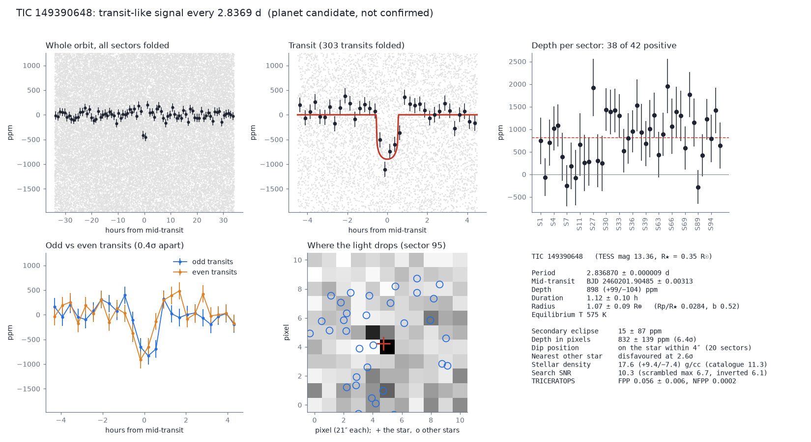

# TIC 149390648.01: planet candidate (not confirmed)

Found in the all-sector re-search of TESS M dwarfs (v1.2.0, 16 November 2026). Star: 2MASS J05361762-6212152.

| | |
|---|---|
| RA, Dec (J2000) | 5h36m17.59s, -62d12m15.3s |
| TESS mag / Gaia G / V | 13.36 / 14.60 / 16.14 |
| Distance | 74.0 pc |
| Star (TIC) | Teff 3382 K, R = 0.345 R☉, M = 0.328 M☉ |
| Period | 2.836870 ± 0.000009 d |
| Mid-transit T0 | BJD_TDB 2460201.90485 ± 0.00313 |
| Depth | 898 (+99 / −104) ppm |
| Duration T14 | 1.12 ± 0.10 h |
| Rp/R★, impact parameter | 0.0284 ± 0.0020, 0.52 (+0.15 / −0.23) |
| Planet radius | 1.07 ± 0.09 R⊕ |
| a/R★, equilibrium temperature | 17.3, 575 K (zero albedo) |
| Data | TESS sectors 2, 3, 4, 5, 6, 7, 9, 10, 11, 12, 13, 27, 28, 29, 30, 31, 32, 33, 34, 35, 36, 37, 38, 39, 61, 62, 63, 64, 65, 66, 67, 68, 69, 87, 88, 89, 90, 93, 94, 95, 96; 303 transits |

## Evidence

- Search: SNR 10.3, SDE 11.4. Same search on 20 sector-scrambled copies with this signal removed: strongest periodic peak SNR 6.7 (SDE 5.5); on the inverted light curve 6.1.
- Positive depth in 39 of 42 sectors (chi2 42.9 for 41 dof).
- Odd vs even transits: 980 ± 125 vs 913 ± 123 ppm (0.4 sigma). Secondary eclipse at phase 0.5: 15 ± 87 ppm.
- Where the dip is (joint fit of the difference images of 20 sectors, 184 transits): a point-source dip is detected at 6.4 sigma, 5.4″ from the star's position at the time of observation, which is within the 4″ accuracy of the method (the star is 0.2 sigma from the best position). Measured in the pixels as a dip of the star itself, the depth is 832 ± 139 ppm (the pixel measurement averages over the central 80 % of the transit and uses a simple PSF, so agreement within about 25 % is expected). The least-excluded other catalogued star that could mimic the signal is TIC 734290358 (T = 20.8, 16.8″ away), disfavoured at 2.6 sigma.
- Stellar density from the transit shape with no prior: 17.6 (+9.4 / −7.4) g/cc; catalogue value 11.3 g/cc.
- TRICERATOPS, 3 runs: FPP = 0.056 ± 0.006, NFPP = 0.0002. Background-star scenarios were not evaluated (no field-star population available), so the true FPP is somewhat higher.
- Neighbours within 42″ bright enough to mimic the signal (TIC): TIC 734290357 at 15.4″, T = 20.44, would need a 52 % eclipse; TIC 734290358 at 15.5″, T = 20.78, would need a 71 % eclipse; TIC 149390651 at 15.9″, T = 17.34, would need a 3 % eclipse; TIC 734290355 at 16.7″, T = 20.07, would need a 37 % eclipse; TIC 734290359 at 18.5″, T = 19.75, would need a 28 % eclipse; TIC 734290356 at 21.3″, T = 19.64, would need a 25 % eclipse; TIC 734290353 at 28.8″, T = 20.19, would need a 42 % eclipse; TIC 734290420 at 35.0″, T = 18.37, would need a 8 % eclipse; TIC 734290361 at 36.5″, T = 18.63, would need a 10 % eclipse; TIC 734290352 at 36.8″, T = 18.46, would need a 8 % eclipse; TIC 149390653 at 37.1″, T = 17.19, would need a 3 % eclipse; TIC 734290376 at 40.4″, T = 19.51, would need a 22 % eclipse; TIC 149390646 at 40.7″, T = 17.02, would need a 2 % eclipse; TIC 734290374 at 40.8″, T = 20.60, would need a 61 % eclipse; TIC 734290373 at 41.4″, T = 20.00, would need a 35 % eclipse.
- Not in: TOI and CTOI lists (2026-11-16), Lastovka et al. 2026, T16 (Roth et al. 2026), DIAmante v1/v2, NEMESIS (Feliz et al. 2021), ahrazzle/comdex4 hobbyist lists. Checked on ExoFOP (no TOI, CTOI or follow-up) and by position within 3′ (no TOI or CTOI on any neighbour); SIMBAD lists no transit paper for this star; not in the candidate table of arXiv:2602.23364. **A pipeline detection does exist:** SPOC 2-min TCE at P = 2.837 d. This page is an independent detection and vetting, not a first report.

## Caveats

- The SPOC pipeline flagged this period as a threshold-crossing event, but it was never made a TOI. I do not know why; the TESS team may have seen a problem that these checks do not.
- The dip is shallow (about 900 ppm on a T = 13.4 star). In the pixel data it is detected at 6.4 sigma using 20 sectors, on the star within the 4″ accuracy of the method. A faint star 17″ away (TIC 734290358, T = 20.8) is disfavoured at only 2.6 sigma, though it would need a 71 % eclipse to produce the signal.
- FPP = 0.056 is above the 0.015 limit used for statistical validation, and background-star scenarios were not evaluated.
- Individual transits are below the noise; the detection rests on 303 transits over 42 sectors adding up, with 39 of 42 sectors showing a positive depth.
- A ground-based check needs a large telescope, and at Dec −62° the star cannot be observed from Korea.

## Files

- `EVIDENCE_TIC149390648.png`: one-page figure
- `fit.json`, `fit_freerho.json`: transit-fit posteriors (density prior / free density)
- `upcoming_transits.md`: next 45 days, KST, with altitude from Busan
- `triceratops_probs.csv`: scenario probabilities of the last run
