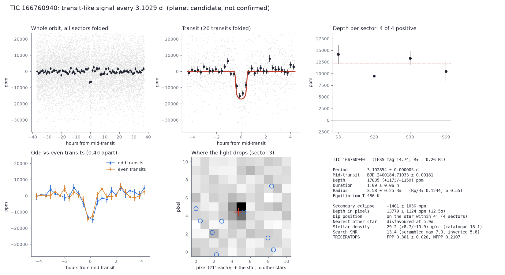

# TIC 166760940.01: planet candidate (not confirmed)

Found in the all-sector re-search of TESS M dwarfs (v1.2.0, 16 November 2026). Star: LEHPM 2538.

| | |
|---|---|
| RA, Dec (J2000) | 2h30m39.83s, -49d19m16.0s |
| TESS mag / Gaia G / V | 14.74 / 16.11 / not listed |
| Distance | 87.6 pc |
| Star (TIC) | Teff 3179 K, R = 0.264 R☉, M = 0.236 M☉ |
| Period | 3.102854 ± 0.000005 d |
| Mid-transit T0 | BJD_TDB 2460184.71033 ± 0.00181 |
| Depth | 17035 (+1173 / −1159) ppm |
| Duration T14 | 1.09 ± 0.06 h |
| Rp/R★, impact parameter | 0.1244 ± 0.0060, 0.55 (+0.11 / −0.17) |
| Planet radius | 3.58 ± 0.25 R⊕ |
| a/R★, equilibrium temperature | 21.4, 486 K (zero albedo) |
| Data | TESS sectors 3, 29, 30, 69; 26 transits |

## Evidence

- Search: SNR 13.4, SDE 12.9. Same search on 30 sector-scrambled copies with this signal removed: strongest periodic peak SNR 7.0 (SDE 5.9); on the inverted light curve 5.8.
- Positive depth in 4 of 4 sectors (chi2 3.7 for 3 dof).
- Odd vs even transits: 11693 ± 1569 vs 12564 ± 1488 ppm (0.4 sigma). Secondary eclipse at phase 0.5: -1461 ± 1036 ppm.
- Where the dip is (joint fit of the difference images of 4 sectors, 30 transits): a point-source dip is detected at 12.5 sigma, 2.9″ from the star's position at the time of observation, which is within the 4″ accuracy of the method (the star is 0.6 sigma from the best position). Measured in the pixels as a dip of the star itself, the depth is 13779 ± 1124 ppm (the pixel measurement averages over the central 80 % of the transit and uses a simple PSF, so agreement within about 25 % is expected). The least-excluded other catalogued star that could mimic the signal is TIC 166760939 (T = 17.7, 12.7″ away), disfavoured at 5.9 sigma.
- Stellar density from the transit shape with no prior: 29.2 (+8.7 / −10.9) g/cc; catalogue value 18.1 g/cc.
- TRICERATOPS, 3 runs: FPP = 0.301 ± 0.020, NFPP = 0.2107. Background-star scenarios were not evaluated (no field-star population available), so the true FPP is somewhat higher.
- Neighbours within 42″ bright enough to mimic the signal (TIC): TIC 166760939 at 16.2″, T = 17.66, would need a 22 % eclipse.
- Not in: TOI and CTOI lists (2026-11-16), Lastovka et al. 2026, T16 (Roth et al. 2026), DIAmante v1/v2, NEMESIS (Feliz et al. 2021), ahrazzle/comdex4 hobbyist lists. Checked on ExoFOP (no TOI, CTOI or follow-up) and by position within 3′ (no TOI or CTOI on any neighbour); no SPOC 2-min TCE and no TESS-SPOC full-frame-image TCE for this star; SIMBAD lists no transit paper for it.

## Caveats

- TRICERATOPS gives FPP = 0.30 and NFPP = 0.21: it cannot exclude an eclipsing binary on TIC 166760939 (16″ away, T = 17.66, needing a 22-25 % eclipse). The joint pixel fit (4 sectors, 12.5 sigma detection) places the dip on the target and disfavours TIC 166760939 at 5.9 sigma, which removes most of that concern; the TRICERATOPS numbers do not use this information.
- Only 26 transits in 4 sectors; the star is faint (T = 14.7), so each transit is detected at low significance.
- A 3.6 R⊕ planet around a 0.26 R☉ star is large for an M dwarf this small (Rp/R★ = 0.12); a grazing eclipsing companion is a live alternative.
- Not observable from Korea (maximum altitude 5°).

## Files

- `EVIDENCE_TIC166760940.png`: one-page figure
- `fit.json`, `fit_freerho.json`: transit-fit posteriors (density prior / free density)
- `upcoming_transits.md`: next 45 days, KST, with altitude from Busan
- `triceratops_probs.csv`: scenario probabilities of the last run
