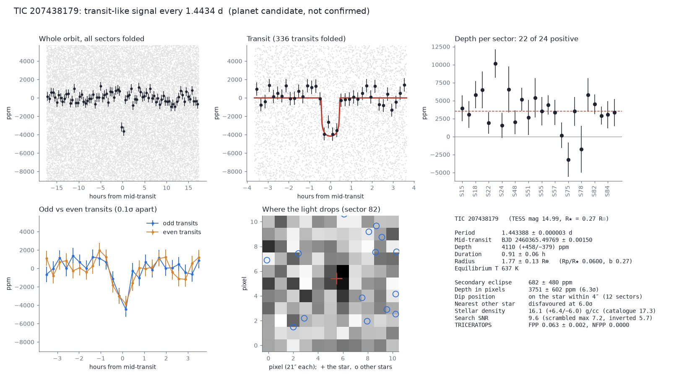

# TIC 207438179.01: planet candidate (not confirmed)

Found in the all-sector re-search of TESS M dwarfs (v1.3.0, 17 November 2026). Star: 2MASS J16175806+5918598.

| | |
|---|---|
| RA, Dec (J2000) | 16h17m58.06s, +59d18m59.9s |
| TESS mag / Gaia G / V | 14.99 / 16.38 / 18.17 |
| Distance | 99.6 pc |
| Star (TIC) | Teff 3154 K, R = 0.271 R☉, M = 0.244 M☉ |
| Period | 1.443388 ± 0.000003 d |
| Mid-transit T0 | BJD_TDB 2460365.49769 ± 0.00150 |
| Depth | 4110 (+458 / −379) ppm |
| Duration T14 | 0.91 ± 0.06 h |
| Rp/R★, impact parameter | 0.0600 ± 0.0033, 0.27 (+0.20 / −0.18) |
| Planet radius | 1.77 ± 0.13 R⊕ |
| a/R★, equilibrium temperature | 12.3, 637 K (zero albedo) |
| Data | TESS sectors 15, 16, 18, 19, 22, 23, 24, 25, 48, 49, 51, 52, 55, 56, 57, 58, 75, 76, 78, 79, 82, 83, 84, 85; 336 transits |

## Evidence

- Search: SNR 9.6, SDE 9.6. Same search on 20 sector-scrambled copies with this signal removed: strongest periodic peak SNR 7.2 (SDE 6.1); on the inverted light curve 5.7.
- Positive depth in 22 of 24 sectors (chi2 32.3 for 23 dof).
- Odd vs even transits: 4042 ± 684 vs 4127 ± 679 ppm (0.1 sigma). Secondary eclipse at phase 0.5: 682 ± 480 ppm.
- Where the dip is (joint fit of the difference images of 12 sectors, 210 transits): a point-source dip is detected at 6.3 sigma, 2.7″ from the star's position at the time of observation, which is within the 4″ accuracy of the method (the star is 0.0 sigma from the best position). Measured in the pixels as a dip of the star itself, the depth is 3751 ± 602 ppm (the pixel measurement averages over the central 80 % of the transit and uses a simple PSF, so agreement within about 25 % is expected). The least-excluded other catalogued star that could mimic the signal is TIC 207438176 (T = 17.6, 50.2″ away), disfavoured at 6.0 sigma.
- Stellar density from the transit shape with no prior: 16.1 (+6.4 / −6.0) g/cc; catalogue value 17.3 g/cc.
- TRICERATOPS, 3 runs: FPP = 0.063 ± 0.002, NFPP = 0.0000. Background-star scenarios were not evaluated (no field-star population available), so the true FPP is somewhat higher.
- Neighbours within 42″ bright enough to mimic the signal (TIC): none.
- Not in (rechecked 17 November 2026): TOI and CTOI lists, Lastovka et al. 2026, T16 (Roth et al. 2026), DIAmante v1/v2, NEMESIS (Feliz et al. 2021), ahrazzle/comdex4 hobbyist lists. Checked on ExoFOP (no TOI, CTOI or follow-up) and by position within 3′ (no TOI or CTOI on any neighbour); none of the 18 catalogue neighbours is in a public candidate list; no SPOC 2-min TCE and no TESS-SPOC full-frame-image TCE for this star; SIMBAD lists only the Gaia nearby-star catalogue for it. Rechecked on 17 November 2026, also against the NASA Exoplanet Archive, the pipeline data-validation reports at MAST, the Lastovka et al. 2026 TCE table, the Gaia DR3 variability tables, the AAVSO VSX variable-star index (nothing within 60″) and an arXiv title/abstract search for the TIC and 2MASS identifiers: no match.

## Caveats

- Faint star (T = 15.0, V = 18.2). Search SNR 9.6 against 7.2 for the strongest peak in 20 scrambled copies; the signal needs all 24 sectors (336 transits). 22 of 24 sectors show a positive depth and 75 % of individual transits are positive, as expected for a signal this weak per transit.
- FPP = 0.063 is above the 0.015 validation limit; NFPP is below 0.0001. Nearly all of the FPP is a planet transiting an unseen bound companion star (0.064); eclipsing-binary scenarios are negligible.
- A dip of 1.4 sigma at phase 0.5 is not significant; a real one would indicate an eclipsing binary.
- Pixel test on 12 sectors: the dip is detected at 6.3 sigma and sits on the target; no star within 50″ is bright enough to mimic it, and the nearest that could (TIC 207438176, T = 17.6, 50″ away) is disfavoured at 6.0 sigma.
- Independent re-reduction from raw aperture flux recovers 1.01 ± 0.10 of the fitted depth (8.8 sigma against other phases; 0.95 expected), with the period scan peaking at exactly the fitted period and three seasons (2019 to 2024) within 6 minutes of a strict period (chi2 2.8 for 3).
- Gaia DR3 shows no sign of a companion (RUWE 1.03, no other source within 25″). Old sky plates: nothing at the star's present position down to G ≈ 20.4 (1946 red plate); fainter background stars are not excluded.
- Circumpolar from Korea (Dec +59), but at V = 18.2 a 0.4 %, 55-minute transit needs a telescope of 1 m or more.

## Files

- `EVIDENCE_TIC207438179.png`: one-page figure
- `fit.json`, `fit_freerho.json`: transit-fit posteriors (density prior / free density)
- `upcoming_transits.md`: next 45 days, KST, with altitude from Busan
- `triceratops_probs.csv`: scenario probabilities of the last run
