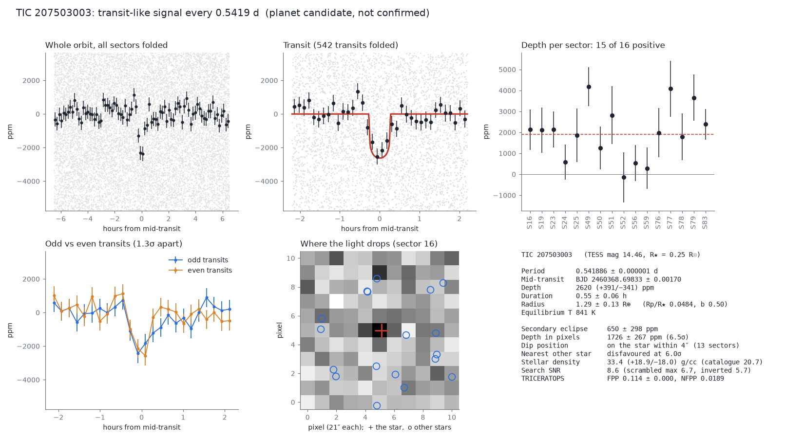

# TIC 207503003.01: planet candidate (not confirmed)

Found in the all-sector re-search of TESS M dwarfs (v1.2.0, 16 November 2026). Star: LP 137-33.

| | |
|---|---|
| RA, Dec (J2000) | 16h32m20.68s, +55d32m17.2s |
| TESS mag / Gaia G / V | 14.46 / 15.85 / not listed |
| Distance | 66.8 pc |
| Star (TIC) | Teff 3132 K, R = 0.245 R☉, M = 0.215 M☉ |
| Period | 0.541886 ± 0.000001 d |
| Mid-transit T0 | BJD_TDB 2460368.69833 ± 0.00170 |
| Depth | 2620 (+391 / −341) ppm |
| Duration T14 | 0.55 ± 0.06 h |
| Rp/R★, impact parameter | 0.0484 ± 0.0043, 0.50 (+0.17 / −0.29) |
| Planet radius | 1.29 ± 0.13 R⊕ |
| a/R★, equilibrium temperature | 6.9, 841 K (zero albedo) |
| Data | TESS sectors 16, 19, 23, 24, 25, 49, 50, 51, 52, 56, 59, 76, 77, 78, 79, 83; 542 transits |

## Evidence

- Search: SNR 8.6, SDE 7.7. Same search on 30 sector-scrambled copies with this signal removed: strongest periodic peak SNR 6.7 (SDE 5.2); on the inverted light curve 5.7.
- Positive depth in 16 of 16 sectors (chi2 22.1 for 15 dof).
- Odd vs even transits: 1794 ± 427 vs 2553 ± 425 ppm (1.3 sigma). Secondary eclipse at phase 0.5: 650 ± 298 ppm.
- Where the dip is (joint fit of the difference images of 13 sectors, 549 transits): a point-source dip is detected at 6.5 sigma, 2.5″ from the star's position at the time of observation, which is within the 4″ accuracy of the method (the star is 0.2 sigma from the best position). Measured in the pixels as a dip of the star itself, the depth is 1726 ± 267 ppm (the pixel measurement averages over the central 80 % of the transit and uses a simple PSF, so agreement within about 25 % is expected). The least-excluded other catalogued star that could mimic the signal is TIC 207503004 (T = 17.0, 51.3″ away), disfavoured at 6.0 sigma.
- Stellar density from the transit shape with no prior: 33.4 (+18.9 / −18.0) g/cc; catalogue value 20.7 g/cc.
- TRICERATOPS, 3 runs: FPP = 0.114 ± 0.000, NFPP = 0.0189. Background-star scenarios were not evaluated (no field-star population available), so the true FPP is somewhat higher.
- Neighbours within 42″ bright enough to mimic the signal (TIC): TIC 1201139399 at 22.0″, T = 20.67, would need a 68 % eclipse; TIC 207503005 at 31.1″, T = 17.66, would need a 4 % eclipse.
- Not in: TOI and CTOI lists (2026-11-16), Lastovka et al. 2026, T16 (Roth et al. 2026), DIAmante v1/v2, NEMESIS (Feliz et al. 2021), ahrazzle/comdex4 hobbyist lists. Checked on ExoFOP (no TOI, CTOI or follow-up) and by position within 3′ (no TOI or CTOI on any neighbour); no SPOC 2-min TCE and no TESS-SPOC full-frame-image TCE for this star; SIMBAD lists no transit paper for it.

## Caveats

- Low signal-to-noise: search SNR 8.6 against 6.7 for the strongest peak in 30 scrambled copies. It is detected only because 16 sectors add up; no single sector shows it convincingly.
- Only 67 % of the individual transits are positive, as expected for a signal this weak, so the per-transit consistency test has little power.
- Phase 0.5 shows 650 ± 298 ppm (2.2 sigma). A real secondary eclipse would mean an eclipsing binary; at this level it can be noise.
- NFPP = 0.019 is above the 0.001 validation limit: TRICERATOPS does not exclude TIC 207503005 (31″ away). The joint pixel fit of 13 sectors detects the dip at 6.5 sigma on the target and disfavours every star able to mimic it at 6 sigma or more, including TIC 207503005.
- The star is faint (T = 14.5) and the transit lasts 33 minutes; ground-based confirmation needs a 1-m class telescope or larger.

## Files

- `EVIDENCE_TIC207503003.png`: one-page figure
- `fit.json`, `fit_freerho.json`: transit-fit posteriors (density prior / free density)
- `upcoming_transits.md`: next 45 days, KST, with altitude from Busan
- `triceratops_probs.csv`: scenario probabilities of the last run
