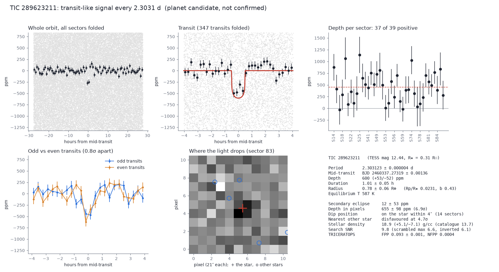

# TIC 289623211.01: planet candidate (not confirmed)

Found in the all-sector re-search of TESS M dwarfs (v1.3.0, 17 November 2026). Star: 2MASS J16564552+6318543.

| | |
|---|---|
| RA, Dec (J2000) | 16h56m45.53s, +63d18m54.2s |
| TESS mag / Gaia G / V | 12.44 / 13.70 / 15.18 |
| Distance | 41.3 pc |
| Star (TIC) | Teff 3341 K, R = 0.309 R☉, M = 0.287 M☉ |
| Period | 2.303123 ± 0.000004 d |
| Mid-transit T0 | BJD_TDB 2460337.27319 ± 0.00136 |
| Depth | 600 (+53 / −52) ppm |
| Duration T14 | 1.01 ± 0.05 h |
| Rp/R★, impact parameter | 0.0231 ± 0.0011, 0.43 (+0.16 / −0.23) |
| Planet radius | 0.78 ± 0.06 R⊕ |
| a/R★, equilibrium temperature | 16.2, 587 K (zero albedo) |
| Data | TESS sectors 14, 15, 17, 18, 19, 21, 22, 23, 24, 25, 26, 40, 41, 47, 48, 49, 51, 52, 55, 56, 57, 58, 59, 60, 73, 74, 75, 76, 78, 79, 80, 81, 82, 83, 84, 85, 86; 347 transits |

## Evidence

- Search: SNR 9.8, SDE 9.3. Same search on 20 sector-scrambled copies with this signal removed: strongest periodic peak SNR 6.6 (SDE 5.7); on the inverted light curve 6.1.
- Positive depth in 38 of 39 sectors (37 with the simpler per-sector estimate plotted in the figure; chi2 34.5 for 38 dof).
- Odd vs even transits: 575 ± 75 vs 494 ± 74 ppm (0.8 sigma). Secondary eclipse at phase 0.5: 12 ± 53 ppm.
- Where the dip is (joint fit of the difference images of 14 sectors, 147 transits): a point-source dip is detected at 6.9 sigma, 3.9″ from the star's position at the time of observation, which is within the 4″ accuracy of the method (the star is 0.1 sigma from the best position). Measured in the pixels as a dip of the star itself, the depth is 655 ± 98 ppm (the pixel measurement averages over the central 80 % of the transit and uses a simple PSF, so agreement within about 25 % is expected). The least-excluded other catalogued star that could mimic the signal is TIC 1271215184 (T = 18.8, 20.1″ away), disfavoured at 4.7 sigma.
- Stellar density from the transit shape with no prior: 18.9 (+5.1 / −7.1) g/cc; catalogue value 13.7 g/cc.
- TRICERATOPS, 3 runs: FPP = 0.093 ± 0.001, NFPP = 0.0004. Background-star scenarios were not evaluated (no field-star population available), so the true FPP is somewhat higher.
- Neighbours within 42″ bright enough to mimic the signal (TIC): TIC 1271215184 at 18.2″, T = 18.75, would need a 16 % eclipse.
- Not in (rechecked 17 November 2026): TOI and CTOI lists, Lastovka et al. 2026, T16 (Roth et al. 2026), DIAmante v1/v2, NEMESIS (Feliz et al. 2021), ahrazzle/comdex4 hobbyist lists. Checked on ExoFOP (no TOI, CTOI or follow-up) and by position within 3′ (no TOI or CTOI on any neighbour); none of the 19 catalogue neighbours is in a public candidate list; no TESS-SPOC full-frame-image TCE for this star; the SPOC 2-min pipeline lists one TCE for it at 884.9 d (a different, unrelated event) and none near 2.303 d; SIMBAD lists six papers for the star (catalogues and target lists), none reporting a transit. Rechecked on 17 November 2026, also against the NASA Exoplanet Archive, the pipeline data-validation reports at MAST (only the unrelated 884.9 d TCE), the Lastovka et al. 2026 TCE table, the Gaia DR3 variability tables, the AAVSO VSX variable-star index (nothing within 60″) and an arXiv title/abstract search for the TIC and 2MASS identifiers: no match.

## Caveats

- Shallow signal: 600 ppm, search SNR 9.8 against 6.6 for the strongest peak in 20 scrambled copies. It is detected only because 39 sectors (347 transits) add up; no single sector shows it.
- FPP = 0.093 is above the 0.015 validation limit. Almost all of it is one scenario: a planet transiting an unseen bound companion star (0.093); every eclipsing-binary scenario is below 0.001. Gaia DR3 shows no sign of a companion (RUWE 1.14, no excess astrometric noise, no second source within 19″), which TRICERATOPS does not use.
- Pixel test on 14 of the 39 sectors (the ones with pixel files downloaded): the dip is detected at 6.9 sigma and sits on the target; the only nearby object able to mimic it (TIC 1271215184, T = 18.8, 20″ west, needing 16 % eclipses) is disfavoured at 4.7 sigma. Gaia flags that object as non-point-like, so it may be a galaxy.
- The older single-sector centroid statistic gives a 6″ offset (3.6 sigma) in the detector frame; it averages sectors with different roll angles and is superseded by the joint fit above, but it is recorded here.
- Independent re-reduction from raw aperture flux recovers 0.84 ± 0.09 of the fitted depth (7.7 sigma against other phases; 0.98 expected), with the period scan peaking at exactly the fitted period and mid-transit times in three seasons (2019–2025) within 3 minutes of a strict period.
- Old sky plates: nothing at the star's present position down to G ≈ 19.6 (1962 blue plate); fainter background stars are not excluded.
- A 0.78 R⊕ planet at 600 ppm cannot be confirmed with a small ground-based telescope; it needs space photometry (e.g. CHEOPS) or precise radial velocities (expected signal about 0.5 m/s, at the limit of current instruments for a V = 15 star).

## Files

- `EVIDENCE_TIC289623211.png`: one-page figure
- `fit.json`, `fit_freerho.json`: transit-fit posteriors (density prior / free density)
- `upcoming_transits.md`: next 45 days, KST, with altitude from Busan
- `triceratops_probs.csv`: scenario probabilities of the last run
