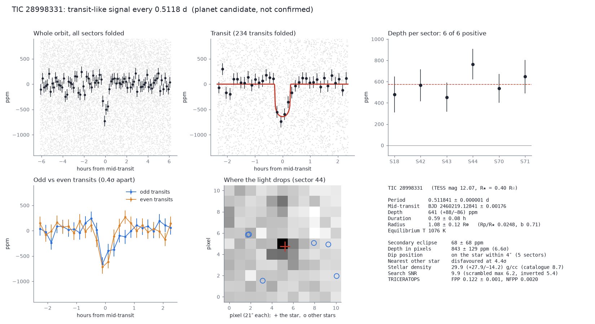

# TIC 28998331.01: planet candidate (not confirmed)

Found in the all-sector re-search of TESS M dwarfs (v1.3.0, 17 November 2026). Star: 2MASS J03212306+2445487.

| | |
|---|---|
| RA, Dec (J2000) | 3h21m23.06s, +24d45m48.4s |
| TESS mag / Gaia G / V | 12.07 / 13.29 / 14.37 |
| Distance | 47.6 pc |
| Star (TIC) | Teff 3409 K, R = 0.399 R☉, M = 0.391 M☉ |
| Period | 0.511841 ± 0.000001 d |
| Mid-transit T0 | BJD_TDB 2460219.12841 ± 0.00176 |
| Depth | 641 (+88 / −86) ppm |
| Duration T14 | 0.59 ± 0.08 h |
| Rp/R★, impact parameter | 0.0248 ± 0.0023, 0.71 (+0.10 / −0.16) |
| Planet radius | 1.08 ± 0.12 R⊕ |
| a/R★, equilibrium temperature | 5.0, 1076 K (zero albedo) |
| Data | TESS sectors 18, 42, 43, 44, 70, 71; 234 transits |

## Evidence

- Search: SNR 9.9, SDE 9.4. Same search on 20 sector-scrambled copies with this signal removed: strongest periodic peak SNR 6.2 (SDE 5.4); on the inverted light curve 5.4.
- Positive depth in 6 of 6 sectors (chi2 6.5 for 5 dof).
- Odd vs even transits: 701 ± 97 vs 653 ± 96 ppm (0.4 sigma). Secondary eclipse at phase 0.5: 68 ± 68 ppm.
- Where the dip is (joint fit of the difference images of 5 sectors, 210 transits): a point-source dip is detected at 6.6 sigma, 1.8″ from the star's position at the time of observation, which is within the 4″ accuracy of the method (the star is 0.0 sigma from the best position). Measured in the pixels as a dip of the star itself, the depth is 843 ± 129 ppm (the pixel measurement averages over the central 80 % of the transit and uses a simple PSF, so agreement within about 25 % is expected). The least-excluded other catalogued star that could mimic the signal is TIC 28998335 (T = 18.3, 19.2″ away), disfavoured at 4.4 sigma.
- Stellar density from the transit shape with no prior: 29.9 (+27.9 / −14.2) g/cc; catalogue value 8.7 g/cc.
- TRICERATOPS, 3 runs: FPP = 0.122 ± 0.001, NFPP = 0.0020. Background-star scenarios were not evaluated (no field-star population available), so the true FPP is somewhat higher.
- Neighbours within 42″ bright enough to mimic the signal (TIC): TIC 28998335 at 21.1″, T = 18.26, would need a 19 % eclipse; TIC 28998336 at 26.4″, T = 18.43, would need a 22 % eclipse; TIC 640886097 at 28.1″, T = 18.84, would need a 32 % eclipse; TIC 640886096 at 33.3″, T = 19.07, would need a 39 % eclipse; TIC 640886098 at 37.8″, T = 19.80, would need a 76 % eclipse.
- Not in (rechecked 17 November 2026): TOI and CTOI lists, Lastovka et al. 2026, T16 (Roth et al. 2026), DIAmante v1/v2, NEMESIS (Feliz et al. 2021), ahrazzle/comdex4 hobbyist lists. Checked on ExoFOP (no TOI, CTOI or follow-up) and by position within 3′ (no TOI or CTOI on any neighbour); none of the 26 catalogue neighbours is in a public candidate list; no SPOC 2-min TCE and no TESS-SPOC full-frame-image TCE for this star; SIMBAD lists only the Gaia nearby-star catalogue for it. Rechecked on 17 November 2026, also against the NASA Exoplanet Archive, the pipeline data-validation reports at MAST, the Lastovka et al. 2026 TCE table, the Gaia DR3 variability tables, the AAVSO VSX variable-star index (nothing within 60″) and an arXiv title/abstract search for the TIC and 2MASS identifiers: no match.

## Caveats

- Shallow signal: 640 ppm, search SNR 9.9 against 6.2 for the strongest peak in 20 scrambled copies. Only six sectors exist (18, 42, 43, 44, 70, 71); it is detected because the 0.51-day period gives 234 transits.
- FPP = 0.12 is above the 0.015 validation limit and NFPP = 0.002 is slightly above the 0.001 limit. Almost all of the FPP is a planet transiting an unseen bound companion star (0.118); eclipsing-binary scenarios sum to about 0.002.
- Gaia DR3 gives RUWE = 1.42 with significant excess astrometric noise (8 sigma). Values above 1.4 are a common sign of an unresolved companion, so the bound-companion scenario above is not excluded and may be more likely than TRICERATOPS assumes. If the transit is on a fainter companion, the planet would be larger than 1.1 R⊕.
- Pixel test on 5 sectors: the dip is detected at 6.6 sigma and sits on the target; the nearest star able to mimic it (TIC 28998335, T = 18.3, 19″ away) is disfavoured at 4.4 sigma.
- Independent re-reduction from raw aperture flux recovers 1.07 ± 0.11 of the fitted depth (13.4 sigma against other phases; 0.98 expected), with the period scan peaking at exactly the fitted period and the two measurable seasons (2021, 2023) within 1.4 minutes of a strict period.
- Old sky plates: nothing at the star's present position down to G ≈ 19.4 (1948 blue plate); fainter background stars are not excluded.
- An ultra-short-period planet (0.51 d, about 1080 K). The transit is 0.6 mmag deep and 36 minutes long: too shallow for a small ground-based telescope even though the star is well placed from Korea in autumn (Dec +25°).

## Files

- `EVIDENCE_TIC28998331.png`: one-page figure
- `fit.json`, `fit_freerho.json`: transit-fit posteriors (density prior / free density)
- `upcoming_transits.md`: next 45 days, KST, with altitude from Busan
- `triceratops_probs.csv`: scenario probabilities of the last run
