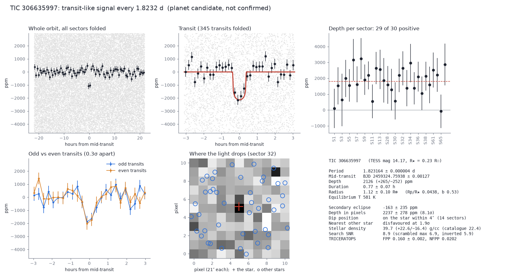

# TIC 306635997.01: planet candidate (not confirmed)

Found in the all-sector re-search of TESS M dwarfs (v1.3.0, 17 November 2026). Star: 2MASS J08000306-6821166.

| | |
|---|---|
| RA, Dec (J2000) | 8h00m03.06s, -68d21m16.7s |
| TESS mag / Gaia G / V | 14.17 / 15.46 / 16.36 |
| Distance | 64.3 pc |
| Star (TIC) | Teff 3311 K, R = 0.234 R☉, M = 0.204 M☉ |
| Period | 1.823164 ± 0.000004 d |
| Mid-transit T0 | BJD_TDB 2459324.75938 ± 0.00127 |
| Depth | 2126 (+265 / −252) ppm |
| Duration T14 | 0.77 ± 0.07 h |
| Rp/R★, impact parameter | 0.0438 ± 0.0033, 0.53 (+0.15 / −0.23) |
| Planet radius | 1.12 ± 0.10 R⊕ |
| a/R★, equilibrium temperature | 16.2, 581 K (zero albedo) |
| Data | TESS sectors 1, 2, 3, 4, 5, 6, 7, 8, 9, 10, 11, 12, 13, 27, 28, 29, 30, 31, 32, 33, 34, 35, 36, 37, 38, 39, 61, 62, 65, 66; 345 transits |

## Evidence

- Search: SNR 8.9, SDE 9.1. Same search on 20 sector-scrambled copies with this signal removed: strongest periodic peak SNR 6.9 (SDE 6.0); on the inverted light curve 5.9.
- Positive depth in 28 of 30 sectors (chi2 17.5 for 29 dof).
- Odd vs even transits: 1926 ± 339 vs 2068 ± 334 ppm (0.3 sigma). Secondary eclipse at phase 0.5: -163 ± 235 ppm.
- Where the dip is (joint fit of the difference images of 14 sectors, 189 transits): a point-source dip is detected at 8.1 sigma, 1.7″ from the star's position at the time of observation, which is within the 4″ accuracy of the method (the star is 0.1 sigma from the best position). Measured in the pixels as a dip of the star itself, the depth is 2237 ± 278 ppm (the pixel measurement averages over the central 80 % of the transit and uses a simple PSF, so agreement within about 25 % is expected). The least-excluded other catalogued star that could mimic the signal is TIC 805869174 (T = 19.9, 9.7″ away), disfavoured at 1.9 sigma.
- Stellar density from the transit shape with no prior: 39.7 (+22.6 / −16.4) g/cc; catalogue value 22.4 g/cc.
- TRICERATOPS, 3 runs: FPP = 0.160 ± 0.002, NFPP = 0.0202. Background-star scenarios were not evaluated (no field-star population available), so the true FPP is somewhat higher.
- Neighbours within 42″ bright enough to mimic the signal (TIC, separations at catalogue epoch J2000; the pixel test above uses positions at the time of observation): TIC 805869174 at 7.9″, T = 19.88, would need a 36 % eclipse; TIC 805869172 at 19.7″, T = 19.98, would need a 39 % eclipse; TIC 306636002 at 26.6″, T = 16.69, would need a 2 % eclipse; TIC 805869175 at 31.2″, T = 17.39, would need a 4 % eclipse; TIC 765048061 at 32.5″, T = 18.91, would need a 15 % eclipse; TIC 805869173 at 37.9″, T = 20.66, would need a 73 % eclipse.
- Not in (rechecked 17 November 2026): TOI and CTOI lists, Lastovka et al. 2026, T16 (Roth et al. 2026), DIAmante v1/v2, NEMESIS (Feliz et al. 2021), ahrazzle/comdex4 hobbyist lists. Checked on ExoFOP (no TOI, CTOI or follow-up) and by position within 3′ (no TOI or CTOI on any neighbour); none of the 68 catalogue neighbours is in a public candidate list; no SPOC 2-min TCE and no TESS-SPOC full-frame-image TCE for this star. Rechecked on 17 November 2026, also against the NASA Exoplanet Archive, the pipeline data-validation reports at MAST, the Lastovka et al. 2026 TCE table, the Gaia DR3 variability tables, the AAVSO VSX variable-star index (nothing within 60″) and an arXiv title/abstract search for the TIC and 2MASS identifiers: no match.

## Caveats

- Low confidence. Search SNR 8.9 against 6.9 for the strongest peak in 20 scrambled copies; the signal needs all 30 sectors (345 transits) and only 70 % of individual transits are positive, as expected for a signal this weak.
- FPP = 0.16 and NFPP = 0.020 are both above the validation limits (0.015 and 0.001). Most of the FPP is a planet transiting an unseen bound companion (0.14); eclipsing binaries on nearby stars add 0.02.
- The pixel test does not rule out the closest neighbour: the joint fit of 14 sectors detects the dip at 8.1 sigma and puts it on the target, but TIC 805869174 (T = 19.9, 8–10″ south-west depending on epoch, a background star by its Gaia parallax) is disfavoured at only 1.9 sigma. It would need eclipses about 40 % deep to produce the signal. Every other star is excluded more strongly.
- The older single-sector centroid statistic gives a 6.9″ offset (3.2 sigma) in the detector frame; it averages sectors with different roll angles and is superseded by the joint fit, but it is recorded here.
- Independent re-reduction from raw aperture flux recovers 1.01 ± 0.10 of the fitted depth (10.2 sigma against other phases; 0.85 expected for a dip on the target, 1.6 sigma apart), with the period scan peaking at exactly the fitted period and the two measurable seasons within 1.4 minutes of a strict period. The 200-second data alone (2023) show 0.74 ± 0.25.
- Gaia DR3 shows no sign of a companion (RUWE 1.07, no second source within 9″). No old sky plate is usable for a background check (no first-epoch survey coverage at this declination; in the later plates the star has moved less than 5″).
- The star is faint (T = 14.2, V = 16.4) and far south (Dec −68): not observable from Korea; a 2100 ppm, 46-minute transit needs a 1-m class southern telescope.

## Files

- `EVIDENCE_TIC306635997.png`: one-page figure
- `fit.json`, `fit_freerho.json`: transit-fit posteriors (density prior / free density)
- `upcoming_transits.md`: next 45 days, KST, with altitude from Busan
- `triceratops_probs.csv`: scenario probabilities of the last run
