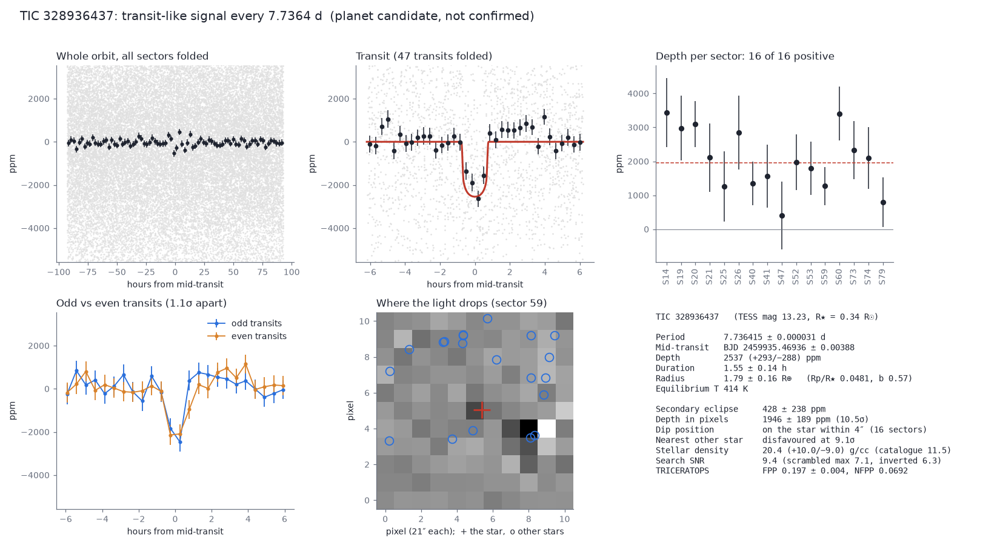

# TIC 328936437.01: planet candidate (not confirmed)

Found in the all-sector re-search of TESS M dwarfs (v1.3.0, 17 November 2026). Star: 2MASS J15021130+8325294 (wide companion of HD 135853).

| | |
|---|---|
| RA, Dec (J2000) | 15h02m11.35s, +83d25m29.5s |
| TESS mag / Gaia G / V | 13.23 / 14.45 / 15.46 |
| Distance | 66.5 pc |
| Star (TIC) | Teff 3407 K, R = 0.342 R☉, M = 0.324 M☉ |
| Period | 7.736415 ± 0.000031 d |
| Mid-transit T0 | BJD_TDB 2459935.46936 ± 0.00388 |
| Depth | 2537 (+293 / −288) ppm |
| Duration T14 | 1.55 ± 0.14 h |
| Rp/R★, impact parameter | 0.0481 ± 0.0034, 0.57 (+0.13 / −0.22) |
| Planet radius | 1.79 ± 0.16 R⊕ |
| a/R★, equilibrium temperature | 33.9, 414 K (zero albedo) |
| Data | TESS sectors 14, 19, 20, 21, 25, 26, 40, 41, 47, 52, 53, 59, 60, 73, 74, 79; 47 transits |

## Evidence

- Search: SNR 9.4, SDE 9.8. Same search on 20 sector-scrambled copies with this signal removed: strongest periodic peak SNR 7.1 (SDE 5.9); on the inverted light curve 6.3.
- Positive depth in 16 of 16 sectors (chi2 16.6 for 15 dof).
- Odd vs even transits: 2215 ± 323 vs 1700 ± 332 ppm (1.1 sigma). Secondary eclipse at phase 0.5: 428 ± 238 ppm.
- Where the dip is (joint fit of the difference images of 16 sectors, 52 transits): a point-source dip is detected at 10.5 sigma, 3.2″ from the star's position at the time of observation, which is within the 4″ accuracy of the method (the star is 0.3 sigma from the best position). Measured in the pixels as a dip of the star itself, the depth is 1946 ± 189 ppm (the pixel measurement averages over the central 80 % of the transit and uses a simple PSF, so agreement within about 25 % is expected). The least-excluded other catalogued star that could mimic the signal is TIC 328936435 (T = 16.9, 25.6″ away), disfavoured at 9.1 sigma.
- Stellar density from the transit shape with no prior: 20.4 (+10.0 / −9.0) g/cc; catalogue value 11.5 g/cc.
- TRICERATOPS, 3 runs: FPP = 0.197 ± 0.004, NFPP = 0.0692. Background-star scenarios were not evaluated (no field-star population available), so the true FPP is somewhat higher.
- Neighbours within 42″ bright enough to mimic the signal (TIC): TIC 328936435 at 24.7″, T = 16.88, would need a 6 % eclipse; TIC 159239266 at 30.2″, T = 18.24, would need a 22 % eclipse; TIC 1102696925 at 34.5″, T = 19.23, would need a 54 % eclipse.
- Not in (rechecked 17 November 2026): TOI and CTOI lists, Lastovka et al. 2026, T16 (Roth et al. 2026), DIAmante v1/v2, NEMESIS (Feliz et al. 2021), ahrazzle/comdex4 hobbyist lists. Checked on ExoFOP (no TOI, CTOI or follow-up for this star or for HD 135853) and by position within 3′ (no TOI or CTOI on any neighbour); none of the 27 catalogue neighbours, including HD 135853, is in a public candidate list or has a pipeline TCE; no SPOC 2-min TCE and no TESS-SPOC full-frame-image TCE for this star; SIMBAD lists only the Gaia nearby-star catalogue for it. Two known eclipsing binaries share the period to 0.01 % (TIC 159720778 and TIC 81702112) but are more than 40° away on the sky, so this is a coincidence. Rechecked on 17 November 2026, also against the NASA Exoplanet Archive, the pipeline data-validation reports at MAST, the Lastovka et al. 2026 TCE table, the Gaia DR3 variability tables, the AAVSO VSX variable-star index (nothing within 60″) and an arXiv title/abstract search for the TIC and 2MASS identifiers: no match.

## Caveats

- The star is the faint companion of a much brighter star: HD 135853 (TIC 159239262, K0, T = 8.6) lies 64″ east with the same parallax and proper motion (a wide binary, about 4200 AU apart in projection). It is 70 times brighter and puts 39 % of the light into this star's TESS aperture, so the first question is which of the two stars dims.
- It is not the bright star: the MIT QLP light curve of HD 135853 itself (10 sectors) shows 29 ± 93 ppm at this ephemeris, where about 2900 ppm would be needed to produce the signal. This rules out the two TRICERATOPS scenarios on that star (0.043 of the FPP below).
- FPP = 0.20 and NFPP = 0.069 as computed are above the validation limits (0.015 and 0.001). The largest part is a planet transiting an unseen bound companion (0.13); HD 135853 accounts for 0.043 (excluded above) and two faint neighbours for 0.019 (excluded by the pixel test at more than 9 sigma). TRICERATOPS cannot use either exclusion.
- Pixel test: the standard version of the test failed here because the bright star's glare dragged the image registration (it reported the dip 11″ west of the star, where Pan-STARRS shows no star bright enough to cause it). Re-run with the positions taken from the pixel-file coordinates instead, the joint fit of 16 sectors detects the dip at 10.5 sigma within 3″ of the target (0.3 sigma), with a depth of 1950 ± 190 ppm that matches the light curve, and disfavours every catalogued neighbour at 9 sigma or more. This is the only candidate analysed with that variant.
- Search SNR 9.4 against 7.1 for the strongest peak in 20 scrambled copies; all 16 sectors show a positive depth and 90 % of the 47 individual transits are positive. A dip of 428 ± 238 ppm at phase 0.5 (1.8 sigma) is not significant but would indicate an eclipsing binary if real.
- Independent re-reduction from raw aperture flux recovers 0.52 ± 0.06 of the fitted depth (8.4 sigma against other phases); 0.61 is expected for a dip on the target after dilution by the bright star (1.5 sigma apart). The period scan peaks at exactly the fitted period; three seasons can be timed and are within 13 ± 7 minutes of a strict period.
- No old sky plate is usable for a background-star check (the star has moved less than 5″ since the plates were taken). Gaia DR3: RUWE 1.21, no other source within 25″.
- The depth depends on the pipeline's correction for the bright star's light. If that correction is off, the planet radius (1.8 R⊕) changes with it.

## Files

- `EVIDENCE_TIC328936437.png`: one-page figure
- `fit.json`, `fit_freerho.json`: transit-fit posteriors (density prior / free density)
- `upcoming_transits.md`: next 45 days, KST, with altitude from Busan
- `triceratops_probs.csv`: scenario probabilities of the last run
