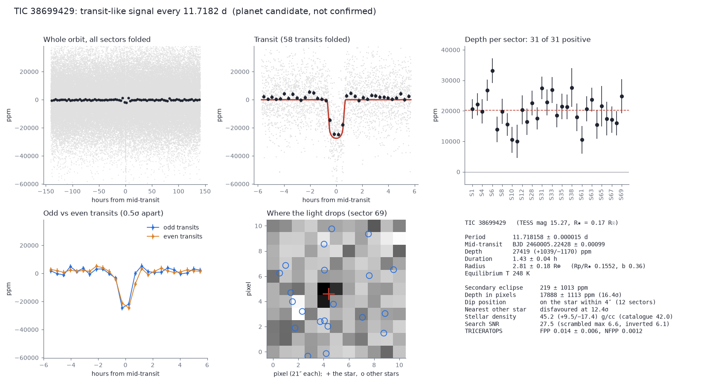

# TIC 38699429.01: planet candidate (not confirmed)

Found in the all-sector re-search of TESS M dwarfs (v1.2.0, 16 November 2026). Star: 2MASS J04244516-6200307.

| | |
|---|---|
| RA, Dec (J2000) | 4h24m45.19s, -62d00m30.7s |
| TESS mag / Gaia G / V | 15.27 / 16.81 / not listed |
| Distance | 57.5 pc |
| Star (TIC) | Teff 2914 K, R = 0.166 R☉, M = 0.137 M☉ |
| Period | 11.718158 ± 0.000015 d |
| Mid-transit T0 | BJD_TDB 2460005.22428 ± 0.00099 |
| Depth | 27419 (+1039 / −1170) ppm |
| Duration T14 | 1.43 ± 0.04 h |
| Rp/R★, impact parameter | 0.1552 ± 0.0040, 0.36 (+0.17 / −0.21) |
| Planet radius | 2.81 ± 0.18 R⊕ |
| a/R★, equilibrium temperature | 68.8, 248 K (zero albedo) |
| Data | TESS sectors 1, 3, 4, 5, 6, 7, 8, 9, 10, 11, 12, 27, 28, 29, 31, 32, 33, 34, 35, 37, 38, 39, 61, 62, 63, 64, 65, 66, 67, 68, 69; 58 transits |

## Evidence

- Search: SNR 27.5, SDE 36.5. Same search on 20 sector-scrambled copies with this signal removed: strongest periodic peak SNR 6.6 (SDE 5.5); on the inverted light curve 6.1.
- Positive depth in 30 of 30 sectors (chi2 29.5 for 29 dof).
- Odd vs even transits: 24122 ± 1346 vs 25120 ± 1386 ppm (0.5 sigma). Secondary eclipse at phase 0.5: 219 ± 1013 ppm.
- Where the dip is (joint fit of the difference images of 12 sectors, 26 transits): a point-source dip is detected at 16.4 sigma, 3.7″ from the star's position at the time of observation, which is within the 4″ accuracy of the method (the star is 0.0 sigma from the best position). Measured in the pixels as a dip of the star itself, the depth is 17888 ± 1113 ppm (the pixel measurement averages over the central 80 % of the transit and uses a simple PSF, so agreement within about 25 % is expected). The least-excluded other catalogued star that could mimic the signal is TIC 38699427 (T = 19.1, 17.8″ away), disfavoured at 12.4 sigma.
- Stellar density from the transit shape with no prior: 45.2 (+9.5 / −17.4) g/cc; catalogue value 42.0 g/cc.
- TRICERATOPS, 3 runs: FPP = 0.014 ± 0.006, NFPP = 0.0012. Background-star scenarios were not evaluated (no field-star population available), so the true FPP is somewhat higher.
- Neighbours within 42″ bright enough to mimic the signal (TIC): TIC 38699427 at 14.8″, T = 19.13, would need a 81 % eclipse; TIC 684942010 at 38.0″, T = 18.89, would need a 66 % eclipse; TIC 38696697 at 41.1″, T = 14.58, would need a 3 % eclipse; TIC 684942008 at 41.7″, T = 18.42, would need a 44 % eclipse.
- Not in: TOI and CTOI lists (2026-11-16), Lastovka et al. 2026, T16 (Roth et al. 2026), DIAmante v1/v2, NEMESIS (Feliz et al. 2021), ahrazzle/comdex4 hobbyist lists. Checked on ExoFOP (no TOI, CTOI or follow-up) and by position within 3′ (no TOI or CTOI on any neighbour); SIMBAD lists no paper for this star; not in the candidate table of arXiv:2602.23364. **A pipeline detection does exist:** TESS-SPOC full-frame-image TCE, sectors 56-69, P = 11.7187 d. This page is an independent detection and vetting with all 31 sectors, not a first report.

## Caveats

- This is not a first detection. The TESS-SPOC pipeline lists a threshold-crossing event (TCE) at 11.7187 d for this star in its sectors 56-69 full-frame-image run. A TCE is an automatic detection, not a candidate designation; the star has no TOI or CTOI, and I do not know whether the TESS team has reviewed it and set it aside.
- The star is faint (T = 15.3, G = 16.8). The planet radius scales with the catalogue stellar radius (0.166 R☉ for a ~2900 K M dwarf), which is uncertain by 10 % or more for stars this cool; no spectrum has been taken.
- The pixel test localises the dip to within about 4″ of the star and excludes every catalogued neighbour at more than 12 sigma, but it cannot exclude an unresolved companion closer than that. Gaia lists no other source within 14″.
- NFPP = 0.0012 is just above the 0.001 limit used for statistical validation, and background-star scenarios were not evaluated.
- Depth has only been measured in the TESS band; a blended eclipsing binary of a different colour would show a different depth in another filter. The 2.7 % depth is easy for a 0.4 to 1 m telescope, but at Dec −62° the star cannot be observed from Korea.

## Files

- `EVIDENCE_TIC38699429.png`: one-page figure
- `fit.json`, `fit_freerho.json`: transit-fit posteriors (density prior / free density)
- `upcoming_transits.md`: next 45 days, KST, with altitude from Busan
- `triceratops_probs.csv`: scenario probabilities of the last run
