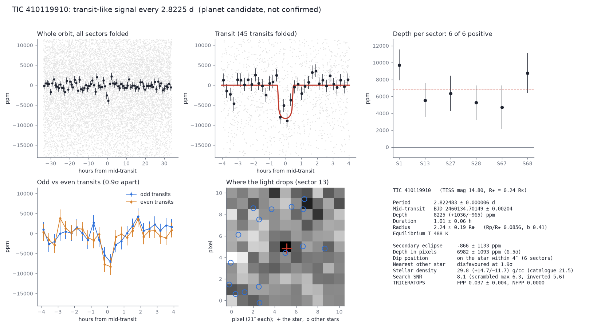

# TIC 410119910.01: planet candidate (not confirmed)

Found in the all-sector re-search of TESS M dwarfs (v1.3.0, 17 November 2026). Star: 2MASS J22272510-7125423.

| | |
|---|---|
| RA, Dec (J2000) | 22h27m25.13s, -71d25m42.3s |
| TESS mag / Gaia G / V | 14.80 / 16.16 / 17.53 |
| Distance | 81.8 pc |
| Star (TIC) | Teff 3184 K, R = 0.239 R☉, M = 0.209 M☉ |
| Period | 2.822483 ± 0.000006 d |
| Mid-transit T0 | BJD_TDB 2460134.70149 ± 0.00204 |
| Depth | 8225 (+1036 / −965) ppm |
| Duration T14 | 1.01 ± 0.06 h |
| Rp/R★, impact parameter | 0.0856 ± 0.0059, 0.41 (+0.18 / −0.24) |
| Planet radius | 2.24 ± 0.19 R⊕ |
| a/R★, equilibrium temperature | 21.3, 488 K (zero albedo) |
| Data | TESS sectors 1, 13, 27, 28, 67, 68; 45 transits |

## Evidence

- Search: SNR 8.1, SDE 6.1. Same search on 20 sector-scrambled copies with this signal removed: strongest periodic peak SNR 6.3 (SDE 5.0); on the inverted light curve 5.6.
- Positive depth in 6 of 6 sectors (chi2 9.0 for 5 dof).
- Odd vs even transits: 9056 ± 1596 vs 7002 ± 1634 ppm (0.9 sigma). Secondary eclipse at phase 0.5: -866 ± 1133 ppm.
- Where the dip is (joint fit of the difference images of 6 sectors, 53 transits): a point-source dip is detected at 6.5 sigma, 2.8″ from the star's position at the time of observation, which is within the 4″ accuracy of the method (the star is 0.1 sigma from the best position). Measured in the pixels as a dip of the star itself, the depth is 6982 ± 1093 ppm (the pixel measurement averages over the central 80 % of the transit and uses a simple PSF, so agreement within about 25 % is expected). The least-excluded other catalogued star that could mimic the signal is TIC 2026146559 (T = 18.7, 7.9″ away), disfavoured at 1.9 sigma.
- Stellar density from the transit shape with no prior: 29.8 (+14.7 / −11.7) g/cc; catalogue value 21.5 g/cc.
- TRICERATOPS, 3 runs: FPP = 0.037 ± 0.004, NFPP = 0.0000. Background-star scenarios were not evaluated (no field-star population available), so the true FPP is somewhat higher.
- Neighbours within 42″ bright enough to mimic the signal (TIC): TIC 2026146559 at 7.8″, T = 18.72, would need a 29 % eclipse; TIC 2026146557 at 30.6″, T = 19.43, would need a 55 % eclipse.
- Not in (rechecked 17 November 2026): TOI and CTOI lists, Lastovka et al. 2026, T16 (Roth et al. 2026), DIAmante v1/v2, NEMESIS (Feliz et al. 2021), ahrazzle/comdex4 hobbyist lists. Checked on ExoFOP (no TOI, CTOI or follow-up) and by position within 3′ (no TOI or CTOI on any neighbour); none of the 20 catalogue neighbours is in a public candidate list; no SPOC 2-min TCE and no TESS-SPOC full-frame-image TCE for this star; SIMBAD lists only the Gaia nearby-star catalogue for it. Rechecked on 17 November 2026, also against the NASA Exoplanet Archive, the pipeline data-validation reports at MAST, the Lastovka et al. 2026 TCE table, the Gaia DR3 variability tables, the AAVSO VSX variable-star index (nothing within 60″) and an arXiv title/abstract search for the TIC and 2MASS identifiers: no match.

## Caveats

- Only six sectors exist (1, 13, 27, 28, 67, 68; 45 transits). Search SNR 8.1 against 6.3 for the strongest peak in 20 scrambled copies; the detection statistic SDE (6.1) is modest. All six sectors show a positive depth and 89 % of individual transits are positive.
- FPP = 0.037 is above the 0.015 validation limit; NFPP is below 0.0001. Nearly all of the FPP is a planet transiting an unseen bound companion star (0.037); eclipsing-binary scenarios are negligible.
- The pixel test does not rule out the closest neighbour: the joint fit of 6 sectors detects the dip at 6.5 sigma and puts it on the target, but TIC 2026146559 (T = 18.7, 8″ away, a blue background star by its Gaia parallax and colour) is disfavoured at only 1.9 sigma. It would need eclipses about 30 % deep. TRICERATOPS gives that scenario a negligible probability because the transit is flat-bottomed with a short ingress, which a deep eclipse on a faint star would not produce.
- Independent re-reduction from raw aperture flux recovers 0.95 ± 0.12 of the fitted depth (7.7 sigma against other phases; 0.94 expected), with the period scan peaking at exactly the fitted period and the two measurable seasons (2018, 2023) within 4 minutes of a strict period. The 10-minute data alone (2020) show a shallower 0.66 ± 0.19.
- Gaia DR3 shows no sign of a companion (RUWE 1.00). Old sky plates: nothing at the star's present position down to G ≈ 19.9 (1974 blue plate); fainter background stars are not excluded.
- The star is faint (T = 14.8, V = 17.5) and far south (Dec −71): not observable from Korea. The transit is deep for its class (0.8 %, 61 minutes), within reach of a 1-m class southern telescope.

## Files

- `EVIDENCE_TIC410119910.png`: one-page figure
- `fit.json`, `fit_freerho.json`: transit-fit posteriors (density prior / free density)
- `upcoming_transits.md`: next 45 days, KST, with altitude from Busan
- `triceratops_probs.csv`: scenario probabilities of the last run
