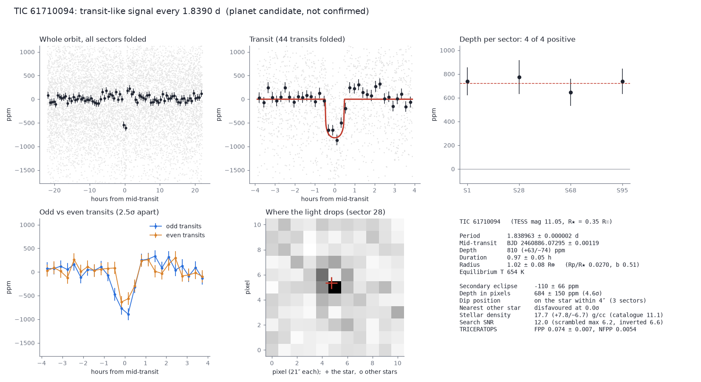

# TIC 61710094.01: planet candidate (not confirmed)

Found in the all-sector re-search of TESS M dwarfs (v1.2.0, 16 November 2026). Star: LP 931-48.

| | |
|---|---|
| RA, Dec (J2000) | 22h21m53.35s, -31d31m22.6s |
| TESS mag / Gaia G / V | 11.05 / 12.32 / 13.52 |
| Distance | 24.1 pc |
| Star (TIC) | Teff 3327 K, R = 0.348 R☉, M = 0.332 M☉ |
| Period | 1.838963 ± 0.000002 d |
| Mid-transit T0 | BJD_TDB 2460886.07295 ± 0.00119 |
| Depth | 810 (+63 / −74) ppm |
| Duration T14 | 0.97 ± 0.05 h |
| Rp/R★, impact parameter | 0.0270 ± 0.0014, 0.51 (+0.13 / −0.20) |
| Planet radius | 1.02 ± 0.08 R⊕ |
| a/R★, equilibrium temperature | 12.9, 654 K (zero albedo) |
| Data | TESS sectors 1, 28, 68, 95; 44 transits |

## Evidence

- Search: SNR 12.0, SDE 12.1. Same search on 30 sector-scrambled copies with this signal removed: strongest periodic peak SNR 6.2 (SDE 5.2); on the inverted light curve 6.6.
- Positive depth in 4 of 4 sectors (chi2 0.5 for 3 dof).
- Odd vs even transits: 975 ± 93 vs 634 ± 96 ppm (2.5 sigma). Secondary eclipse at phase 0.5: -110 ± 66 ppm.
- Where the dip is (joint fit of the difference images of 3 sectors, 37 transits): a point-source dip is detected at 4.6 sigma, 3.6″ from the star's position at the time of observation, which is within the 4″ accuracy of the method (the star is 0.0 sigma from the best position). Measured in the pixels as a dip of the star itself, the depth is 684 ± 150 ppm (the pixel measurement averages over the central 80 % of the transit and uses a simple PSF, so agreement within about 25 % is expected). The least-excluded other catalogued star that could mimic the signal is TIC 2028139236 (T = 18.6, 5.2″ away), disfavoured at 0.0 sigma.
- Stellar density from the transit shape with no prior: 17.7 (+7.8 / −6.7) g/cc; catalogue value 11.1 g/cc.
- TRICERATOPS, 3 runs: FPP = 0.074 ± 0.007, NFPP = 0.0054. Background-star scenarios were not evaluated (no field-star population available), so the true FPP is somewhat higher.
- Neighbours within 42″ bright enough to mimic the signal (TIC): TIC 2028139236 at 10.9″, T = 18.56, would need a 73 % eclipse; TIC 2028139237 at 12.1″, T = 17.15, would need a 20 % eclipse.
- Not in: TOI and CTOI lists (2026-11-16), Lastovka et al. 2026, T16 (Roth et al. 2026), DIAmante v1/v2, NEMESIS (Feliz et al. 2021), ahrazzle/comdex4 hobbyist lists. Checked on ExoFOP (no TOI, CTOI or follow-up) and by position within 3′ (no TOI or CTOI on any neighbour); SIMBAD lists no transit paper for this star. **A pipeline detection does exist:** SPOC 2-min TCE at P = 1.8389 d in three multi-sector runs (sectors 1-36, 1-69, 1-96). This page is an independent detection and vetting, not a first report.

## Caveats

- The SPOC pipeline flagged this period as a threshold-crossing event in three multi-sector runs, but it was never made a TOI. I do not know why; the TESS team may have seen a problem that these checks do not.
- Odd and even transits differ at 2.5 sigma. An eclipsing binary at twice the period would do that; with two sets of 22 shallow transits this can also be noise.
- NFPP = 0.0054 is above the 0.001 limit used for statistical validation: TIC 2028139237 (12″ away) is not excluded by TRICERATOPS. The joint pixel fit (3 usable sectors, 4.6 sigma) puts the dip on the target within its 4″ accuracy, but it cannot separate the target from TIC 2028139236 (T = 18.6, about 5″ away at the time of observation), which would need a 73 % eclipse to produce the signal; TIC 2028139237 is disfavoured at 2.7 sigma.
- Depth is only 810 ppm (0.9 mmag); a ground-based check needs a large telescope, and the star never rises above 23° from Korea.

## Files

- `EVIDENCE_TIC61710094.png`: one-page figure
- `fit.json`, `fit_freerho.json`: transit-fit posteriors (density prior / free density)
- `upcoming_transits.md`: next 45 days, KST, with altitude from Busan
- `triceratops_probs.csv`: scenario probabilities of the last run
