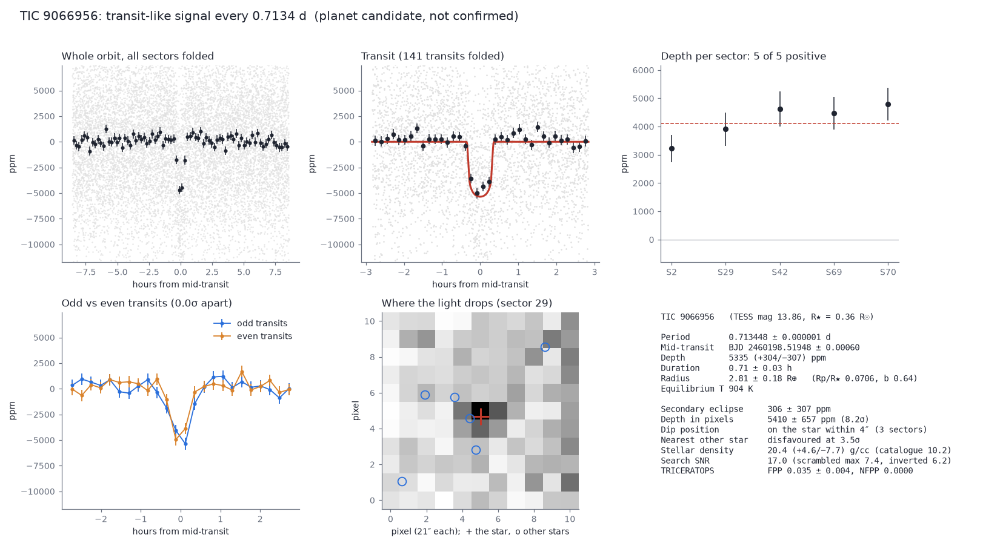

# TIC 9066956.01: planet candidate (not confirmed)

Found in the all-sector re-search of TESS M dwarfs (v1.2.0, 16 November 2026). Star: 2MASS J23462610-1147476.

| | |
|---|---|
| RA, Dec (J2000) | 23h46m26.11s, -11d47m47.8s |
| TESS mag / Gaia G / V | 13.86 / 15.15 / 16.59 |
| Distance | 89.5 pc |
| Star (TIC) | Teff 3299 K, R = 0.365 R☉, M = 0.351 M☉ |
| Period | 0.713448 ± 0.000001 d |
| Mid-transit T0 | BJD_TDB 2460198.51948 ± 0.00060 |
| Depth | 5335 (+304 / −307) ppm |
| Duration T14 | 0.71 ± 0.03 h |
| Rp/R★, impact parameter | 0.0706 ± 0.0027, 0.64 (+0.08 / −0.09) |
| Planet radius | 2.81 ± 0.18 R⊕ |
| a/R★, equilibrium temperature | 6.7, 904 K (zero albedo) |
| Data | TESS sectors 2, 29, 42, 69, 70; 141 transits |

## Evidence

- Search: SNR 17.0, SDE 18.5. Same search on 30 sector-scrambled copies with this signal removed: strongest periodic peak SNR 7.4 (SDE 6.6); on the inverted light curve 6.2.
- Positive depth in 5 of 5 sectors (chi2 5.1 for 4 dof).
- Odd vs even transits: 5062 ± 430 vs 5067 ± 422 ppm (0.0 sigma). Secondary eclipse at phase 0.5: 306 ± 307 ppm.
- Where the dip is (joint fit of the difference images of 3 sectors, 105 transits): a point-source dip is detected at 8.2 sigma, 1.3″ from the star's position at the time of observation, which is within the 4″ accuracy of the method (the star is 0.1 sigma from the best position). Measured in the pixels as a dip of the star itself, the depth is 5410 ± 657 ppm (the pixel measurement averages over the central 80 % of the transit and uses a simple PSF, so agreement within about 25 % is expected). The least-excluded other catalogued star that could mimic the signal is TIC 2052361291 (T = 18.5, 12.8″ away), disfavoured at 3.5 sigma.
- Stellar density from the transit shape with no prior: 20.4 (+4.6 / −7.7) g/cc; catalogue value 10.2 g/cc.
- TRICERATOPS, 3 runs: FPP = 0.035 ± 0.004, NFPP = 0.0000. Background-star scenarios were not evaluated (no field-star population available), so the true FPP is somewhat higher.
- Neighbours within 42″ bright enough to mimic the signal (TIC): TIC 2052361291 at 12.8″, T = 18.53, would need a 35 % eclipse; TIC 9066964 at 35.4″, T = 18.77, would need a 44 % eclipse; TIC 9066954 at 39.1″, T = 16.86, would need a 8 % eclipse.
- Not in: TOI and CTOI lists (2026-11-16), Lastovka et al. 2026, T16 (Roth et al. 2026), DIAmante v1/v2, NEMESIS (Feliz et al. 2021), ahrazzle/comdex4 hobbyist lists. Checked on ExoFOP (no TOI, CTOI or follow-up) and by position within 3′ (no TOI or CTOI on any neighbour); no SPOC 2-min TCE and no TESS-SPOC full-frame-image TCE for this star; SIMBAD lists no transit paper for it.

## Caveats

- A 2.8 R⊕ planet on a 0.71-day orbit is rare (few sub-Neptunes are known this close to their star), so the prior odds of a false positive are higher than TRICERATOPS assumes.
- The free-density fit prefers a denser star than the catalogue (20 vs 10 g/cc, about 1.3 sigma).
- Sector 42 pixel data are unusable (scattered light); the pixel test rests on sectors 29, 69 and 70. In those the dip is on the target (8.2 sigma detection) and the nearest star able to mimic it (TIC 2052361291, 13″ away) is disfavoured at 3.5 sigma.
- The first pass flagged this period as "shared with other stars"; those stars are all tens of degrees away, so it is a coincidence of common short periods, not contamination.

## Files

- `EVIDENCE_TIC9066956.png`: one-page figure
- `fit.json`, `fit_freerho.json`: transit-fit posteriors (density prior / free density)
- `upcoming_transits.md`: next 45 days, KST, with altitude from Busan
- `triceratops_probs.csv`: scenario probabilities of the last run
